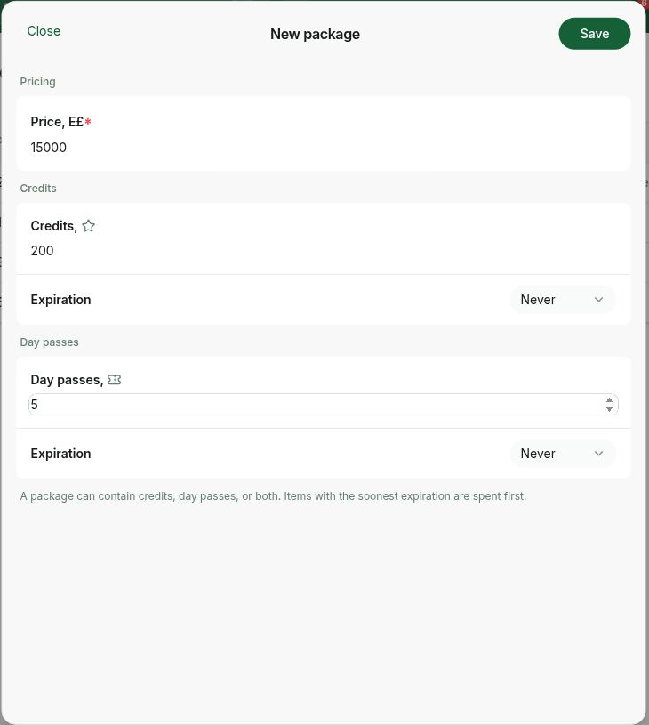
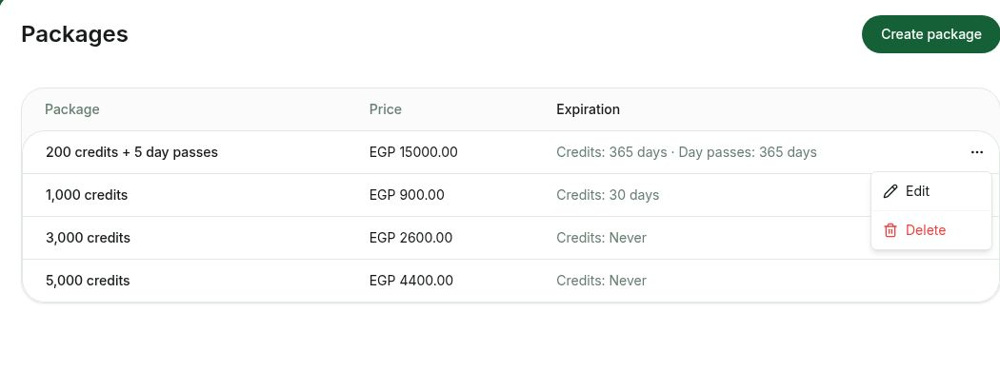

Packages are bundles of credits, day passes, or both that members can purchase and use for bookings, shop orders, or event tickets.

Use packages to:

* Sell one-time bundles of credits and day passes for members who need occasional access rather than a recurring plan
* Let members purchase more when they run out of credit or day passes in their subscription
* Create packages with custom expiration periods or non-expiring packages
* Encourage credit payments, reducing small transactions and payment processing fees.

## Create packages

1. Go to **Catalog** > **Packages**.
2. Click **Create package**.
3. Enter the package price.
4. Enter the number of credits, day passes, or both to create a mixed package.
5. Configure expiration separately for credits and day passes. Leave **Expiration** off for no expiry, or enable it and enter **Days after purchase** from 1 to 3650.
6. Click **Save**.

<Frame>
  
</Frame>

## How members buy packages

1. Members buy packages from the **Membership > Credits** and **Day passes** pages.
   * Individual members — under the **Personal** section.
   * Company managers and members — under the company section.
   <Frame>
   </Frame>
2. Complete the purchase with an available payment method, then check the balance and transaction history for the credits or day passes. A pending payment screen does not confirm that the package was granted. Each allowance remains usable until its own expiration date, if configured.

<Info>
  Only members can see, buy, and use packages — nonmembers cannot:

  * [Invite](/admin/customer-management/users/members#invite-a-member) them as a member so they can buy a package, or
  * Nonmembers can [sign up for plans](/admin/billing/plans/set-up-plans) with credits and day passes instead.
</Info>

<Info>
  Company members (non-managers) can only purchase packages for their company if they have a [permission](/admin/customer-management/companies/company-payment-method-permissions) to use company card or company invoice for this.
</Info>

## Manage packages

To edit or delete a package:

1. Go to **Catalog** > **Packages**.
2. Press **(...)** next to the necessary package and tap **Edit** or **Delete**.

<Frame>
  
</Frame>

## Best practices

To encourage package sales:

* Price larger packages slightly below their equivalent monetary value, or
* Give members [discounts on packages](/admin/billing/discounts/apply-discounts-to-bookings-and-purchases) of credits and day passes.

This encourages customers to prepay upfront and increases their commitment to your space.

## FAQs

<Accordion title="Where can members see transactions for their package purchases?">
  * If purchased by card — on the **Membership** > **Billing** > **Transactions** page.
  * If purchased with an invoice — on the **Membership** > **Billing** page > **Upcoming invoice** or **Invoices**.
  * Package purchases are also reflected in their credit history on the **Membership** > **Credits/Day passes** > **Transactions** page.
</Accordion>

<Accordion title="Where can I track customers' credit package purchases?">
  * Enable [notifications](/admin/administration/your-account/notifications/set-up-notifications) for  package purchases.
  * Use the **Payments** tab on [**Analytics**](/admin/analytics-reports/dashboards) to monitor package sales.
  * Generate **Transactions** [custom report](/admin/analytics-reports/reports) > filter it by **Package** type.
</Accordion>

<Accordion title="How does a package differ from a membership plan?">
  A package is a one-time purchase of credits or day passes and does not renew itself. A membership plan defines a subscription cycle and recurring allowances. Use a package for a top-up or occasional use.
</Accordion>

<Accordion title="Is a recurring subscription required to buy a package?">
  The customer needs membership at the location and an eligible payment method. Being a location member is different from holding a recurring subscription plan.
</Accordion>

<Accordion title="Can an administrator add a balance without buying a package?">
  Administrators can [manage credits](/admin/billing/credits-and-day-passes/credits#add-credits) or [day passes](/admin/billing/credits-and-day-passes/day-passes) from the customer's profile. A manual balance adjustment is different from a package purchase; review its reason and transaction record.
</Accordion>

<Accordion title="Can credits and day passes expire on different dates?">
  Yes. Configure each allowance's expiration separately in a mixed package and check both settings before saving.
</Accordion>
