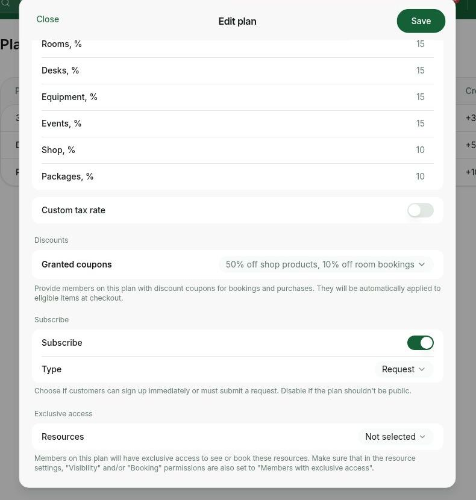
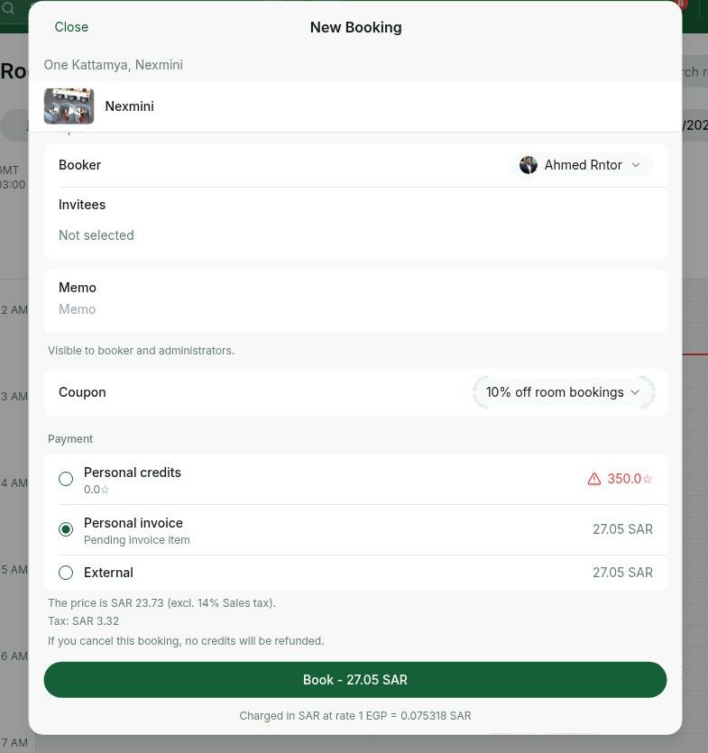
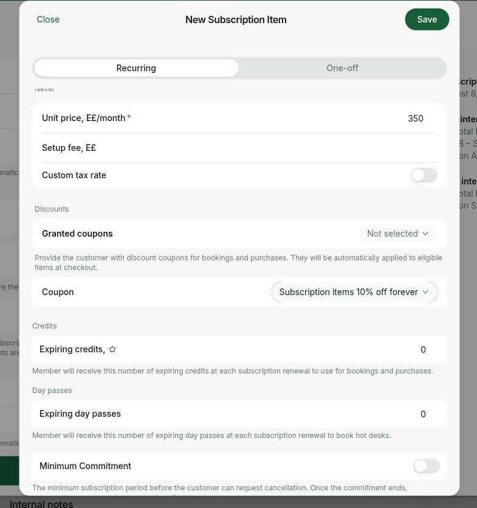
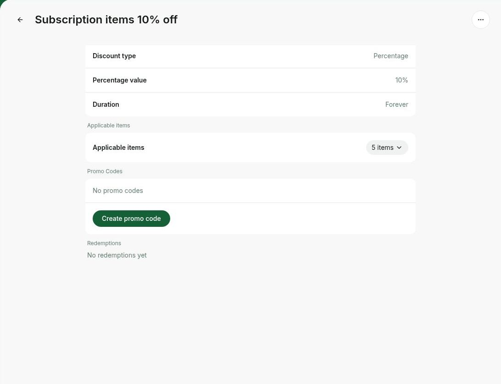
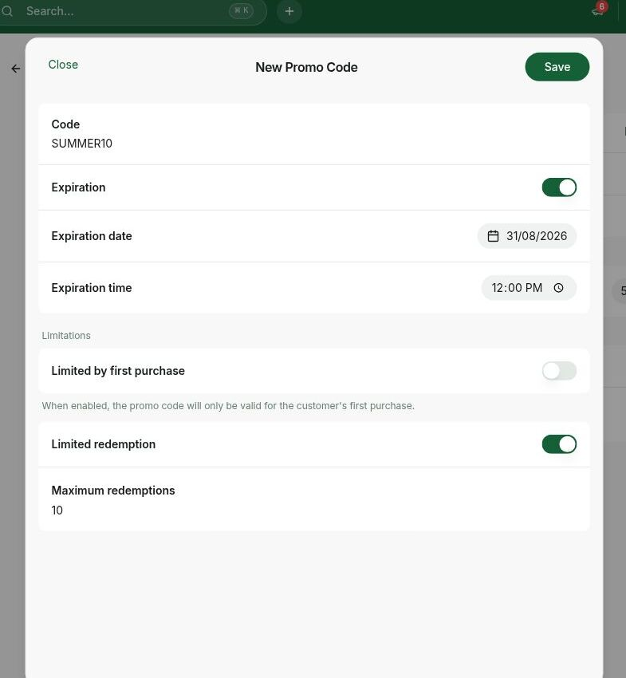
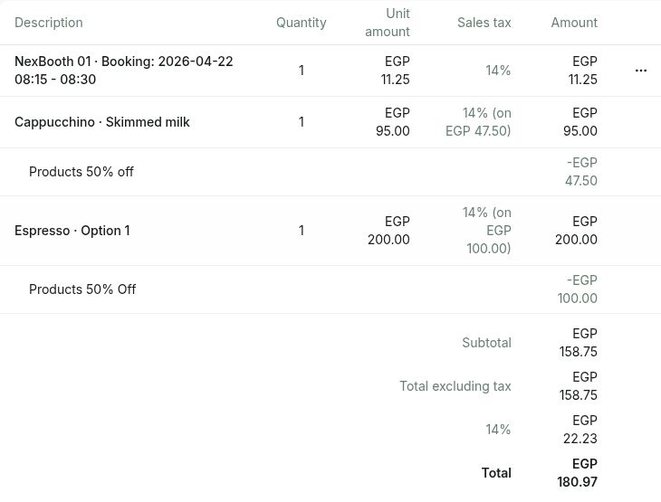
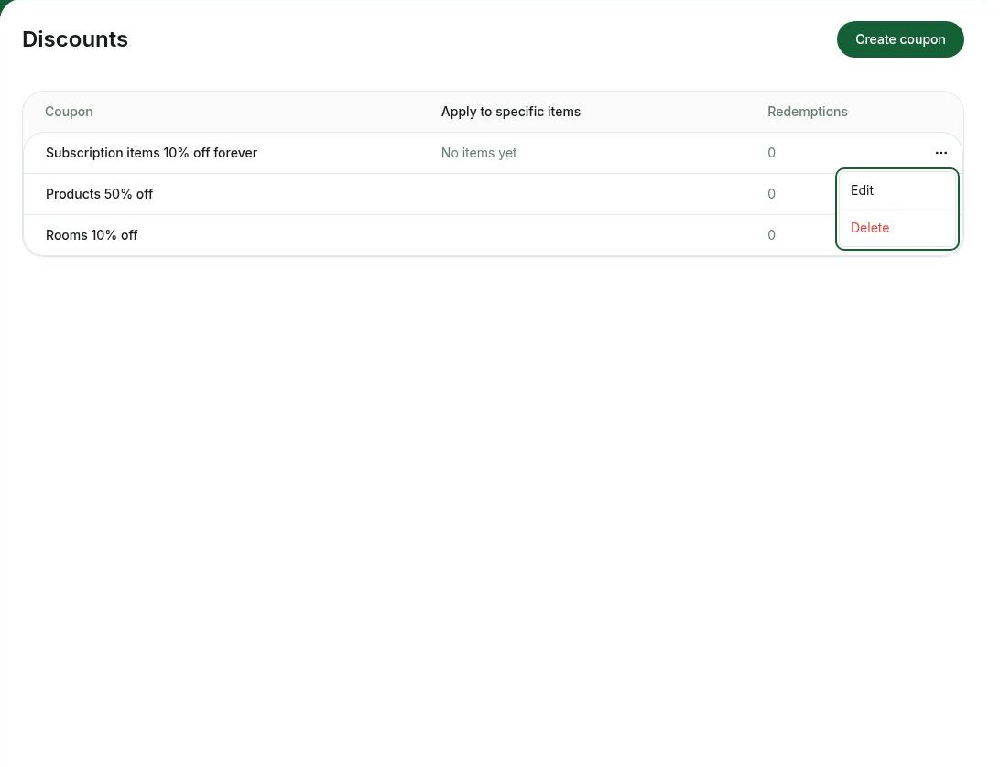

Once you [create discount coupons](/admin/billing/discounts/coupons-and-promo-codes), you can give discounts to customers with membership plans and subscriptions, apply them directly to specific customers' bookings or subscriptions, or generate promo codes to share with targeted customers or use in marketing campaigns.

## Give discounts with plans and subscriptions

You can give your members discounts on specific products and services as part of their membership. These discounts are then automatically applied for them at checkout.

### Give a discount to a specific member or company

To give a discount to a specific member or company, grant coupons directly in their subscription.

1. Go to **Customers** and open the user or company profile.
2. [Open their existing subscription](/admin/billing/subscriptions/edit-a-subscription) or [create a new one](/admin/billing/subscriptions/set-up-subscriptions).
3. Open the subscription item.
4. Locate the **Discounts** section and, in the **Granted coupons** field, select the discounts to give the customer.
5. Press **Save** twice.

<Info>
  This is different from applying a [coupon directly to a subscription item's price](/admin/billing/discounts/apply-discounts-to-bookings-and-purchases#to-subscriptions), which discounts that item itself (e.g., the rent for a desk or office). **Granted coupons** doesn't discount the item — it makes the customer eligible for automatic discounts on other eligible products and bookings at checkout.
</Info>

### Give a discount to all subscribers of a plan or resource tier

To give the same discount to every member who signs up for a plan or resource tier, add coupons to it directly.

1. Open the plan or resource tier you want to include discounts with:
   * **For a plan** — go to **Catalog** > **Memberships** and open the membership, then the [plan](/admin/billing/plans/set-up-plans) under **Plans**.
   * **For an office, desk, or other resource** — offices, desks, and other resources are rented through a [resource tier](/admin/resource-management/resources/set-up-pricing#set-up-pricing-for-resource-rentals) rather than a plan, so open the resource on its **Resources** page (for example, **Offices** or **Desks**) and edit the tier you want.
2. Locate the **Discounts** section.
3. In **Granted coupons**, select the required discounts and save the plan. For a membership, save the membership window too.
4. Review existing subscribers' items separately. If the intended coupons are not present, open the subscription, add them in **Granted coupons**, and save.

<Frame>
  
</Frame>

### How granted coupons apply at checkout

* Customers see full, standard prices for all products in the member portal.
* At checkout, the system selects the best eligible discount for the payment method and shows the discounted total before confirmation. Monetary and credit payments may qualify for different discounts.

<Frame>
</Frame>

Customers can also:

* Select to apply a different coupon if they have a few.
* Enter a promo code. If a promo code is entered, it takes priority over any coupon and replaces it for that transaction. The promo code and the granted coupon do not combine; only the promo code discount applies.

<Info>
  If a customer has active subscriptions with multiple coupons applicable to the same product at the same location — for example, both a personal and a company subscription — the best available coupon across all their subscriptions is automatically applied at checkout to ensure they pay the lowest price.
</Info>

<Tip>
  Granted coupons work only in the location where the customer holds the subscription. If their discount must be valid in another location as well, [create a promo code](/admin/billing/discounts/apply-discounts-to-bookings-and-purchases#create-promo-codes) in that location and share it with the member.
</Tip>

## Apply discounts to specific customers' bookings and subscriptions

### To bookings

To apply a discount when making a booking for the customer:

1. Go to the **Rooms**, **Desks**, **Parking**, or **Equipment** page and start a booking.
2. Select the customer in the **Booker** field.
3. Select a coupon in the **Coupon** field.
4. Review the discounted price and confirm the booking.

<Frame>
  
</Frame>

### To subscriptions

To apply a discount to the customer's subscription price:

1. Go to **Customers** and open the user or company profile.
2. [Open their existing subscription](/admin/billing/subscriptions/edit-a-subscription) or [create a new one](/admin/billing/subscriptions/set-up-subscriptions).
3. Click the subscription item to apply the discount to.
4. Choose a coupon in the **Coupon** field. Press **Save** twice.

<Frame>
  
</Frame>

<Info>
  You can apply a different coupon to each item within a subscription — discount only one specific item, or apply different discounts to different items.
</Info>

## Create promo codes

A promo code is a unique code — for example, *SUMMER20* — linked to a coupon. You can create and share promo codes with specific customers or distribute it broadly for a promotion or marketing campaign.

To create a promo code:

1. Go to **Catalog** > **Discounts**.
2. Select the coupon the promo code should be linked to.
3. Click **Create promo code**.

<Frame>
  
</Frame>

4. Configure the promo code properties.

<Frame>
  
</Frame>

|                               |                                                                                                                                                                                                                                                                              |
| :---------------------------- | :--------------------------------------------------------------------------------------------------------------------------------------------------------------------------------------------------------------------------------------------------------------------------- |
| **Code**                      | The code customers enter at checkout to redeem the discount.                                                                                                                                                                                                                 |
| **Expiration** | Enable it and choose the expiration date and time. Check the selected time; do not assume the code remains valid until the end of that day. |
| **Limited by first purchase** | Enable to make the promo code valid only for customers making their first purchase of this product type at the location.                                                                                                                                                     |
| **Limited redemption**        | Enable to limit how many times the promo code can be redeemed across all customers. The promo code redemption limit cannot exceed the coupon's redemption limit. The limit applies to transactions — if the limit is 5, the promo code can be used for 5 separate purchases. |

<Info>
  You can change a promo code from its details page using **Edit**, then **Save**. Delete the code from its menu when it should no longer be used.
</Info>

5. Share the promo code directly with customers or publish it in your marketing campaign. Customers enter it at checkout to redeem the discount.

<Tip>
  Explore the [most common discount scenarios](/guides/promotion/use-coupons-and-promo-codes) and setup examples.
</Tip>

### How customers apply promo codes

Customers can apply promo codes in the member portal during checkout:

1. Start a booking, subscription sign-up, or other purchase.
2. Enter the promo code in the **Promo code** field.
3. Review the discounted price and confirm payment.

<Frame>
</Frame>

Once a coupon or promo code is applied, the discount appears in transaction and invoice details, as well as on invoice and receipt PDFs.

<Frame>
  
</Frame>

<Info>
  Customers enter a promo code when purchasing a new subscription, including an additional subscription. To discount a subscription that is already running, an administrator applies a coupon to its subscription item.
</Info>

## Track coupon and promo code usage

To see how many times each discount has been redeemed, who redeemed it, and when:

1. Go to **Catalog** > **Discounts**.
2. Open a coupon or promo code to view:

* Total redemptions
* Customer name
* Product the coupon or promo code was applied to
* Redemption date

<Frame>
</Frame>

<Info>
  For broader analytics, export the [**Invoice items report**](/admin/analytics-reports/reports) to analyze discount usage. The report provides information about all the discount applications.
</Info>

## Delete a coupon

Delete a coupon when you no longer want the discount to be redeemable. For this:

1. Go to **Catalog** > **Discounts**.
2. Click **(...)** next to the coupon > **Delete**.

<Frame>
  
</Frame>

Deleting the coupon also deletes its associated promo codes. Review subscriptions and promotions that rely on it before deleting.

## Delete a promo code

To remove a promo code after a promotion ends:

1. Go to **Catalog** > **Discounts**.
2. Select the coupon associated with the promo code.
3. Click **(...)** next to the promo code, select **Delete**, and confirm.

<Frame>
</Frame>

After deletion, the code cannot be used for new purchases.

## FAQs

<Accordion title="Why is the user seeing the 'Promo code is not valid' error?">
  This error typically appears for one of the following reasons:

  * The code might have been entered with a typo or extra spaces. Please double-check it.
  * The promo code might be **Limited by first purchases**, and the user might have already purchased this product type previously. You can verify the user's previous purchases in their profile under **Customers**.
  * The promo code might be redeemable for product types different from what the user is trying to purchase. Check the promo code and its associated coupon to confirm its eligible products types.
  * The coupon might be limited to specific items, and the selected item is not eligible. Review the **Applicable items** section for the relevant coupon.
  * The promo code might have expired. Check its expiration date.
  * The promo code or associated coupon might have reached the redemption limit.
  * The promo code or its associated coupon may have been deleted.

  You can verify the promo code settings on the **Catalog > Discounts** page.
</Accordion>

<Accordion title="How does a discount for subscription items take effect?">
  * For new subscriptions, the discount takes effect on the subscription start date and applies to their first subscription payment.
  * For existing subscriptions, the discount takes effect on the next renewal date.

  The discount duration is determined by the [coupon's **Duration type**](/admin/billing/discounts/coupons-and-promo-codes) and begins when the discount takes effect.

  If the coupon's **Duration type** is other than "Once," the discount is applied to subsequent subscription invoices for the defined period.

  * For coupons with the **Repeating** duration type applied to a non-monthly subscription, the discount applies to all invoices generated during the configured number of months.

  Examples:

  * A coupon with a **3-month** duration applied to a yearly subscription discounts only the first yearly invoice, since only one invoice is generated during that period. The discount applies to the full yearly subscription price, not a prorated 3-month amount.
  * For a weekly subscription, the discount covers eligible invoices within the three-month period; the number of invoices depends on their dates.
</Accordion>

<Accordion title="How do I change or remove a customer's granted discount?">
  Open **Customers**, then the customer's or company's subscription, and select the item granting the discount. In **Granted coupons**, remove the old coupon or select a replacement, then save the item and subscription. To change a shared coupon's rules, open it in **Catalog** > **Discounts** and choose **Edit**.
</Accordion>

<Accordion title="Can selected members pay less for the same room?">
  Create a room coupon, enable **Apply to specific items**, select the rooms, and grant the coupon in the relevant customers' subscriptions. Review the final amount and payment method when booking; credit discounts require **Applicable to credits** on the coupon.
</Accordion>

<Accordion title="Why does a booking total differ from the resource's standard price?">
  Check the booking's payment details for the discount or promo code used, then review granted coupons in the customer's personal or company subscription. A later coupon change does not mean the price recorded for the original booking was incorrect.
</Accordion>

<Accordion title="Does a promo code combine with a granted coupon?">
  No. A valid promo code replaces the granted coupon for the transaction. Review the final total before confirming payment.
</Accordion>
