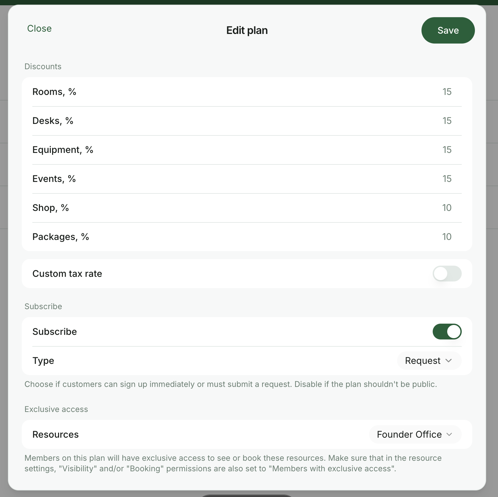
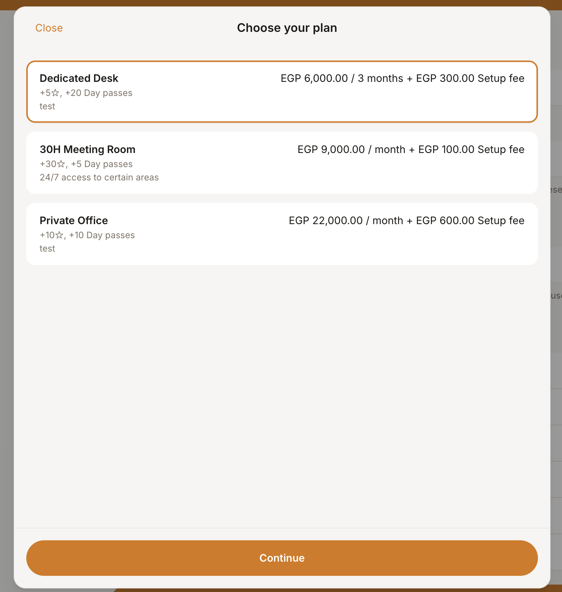
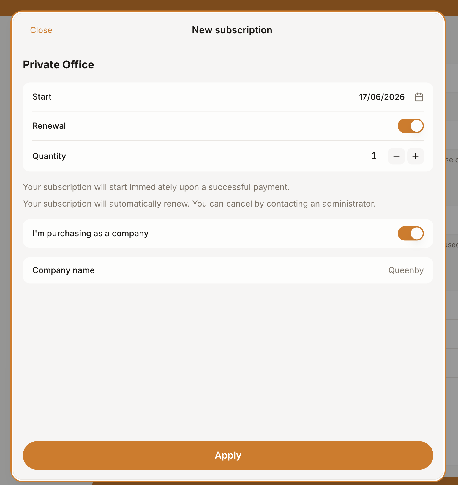
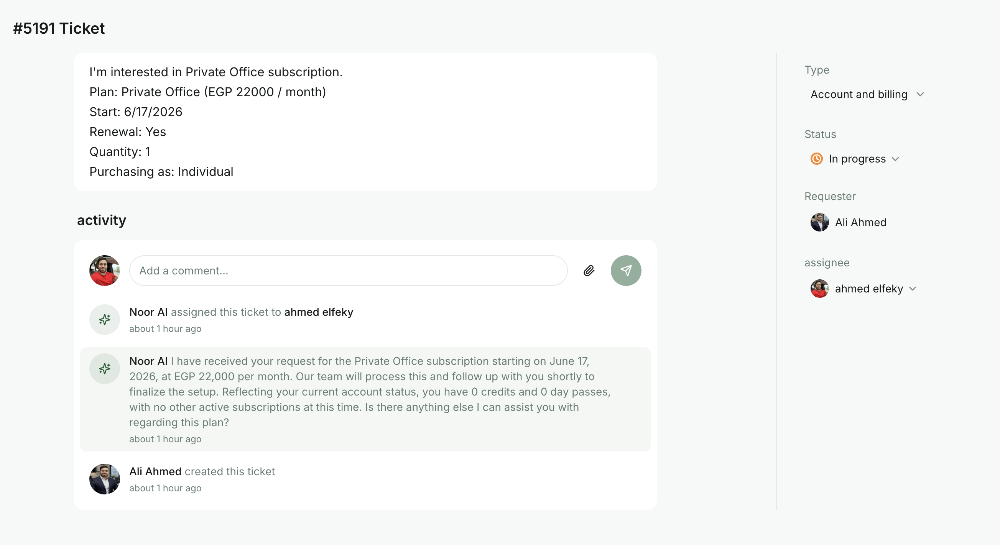
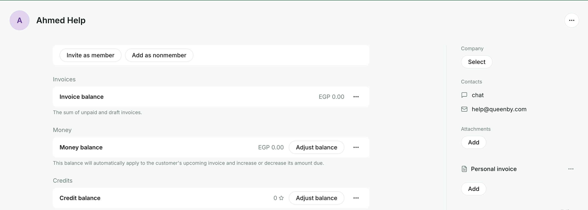
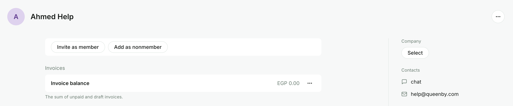
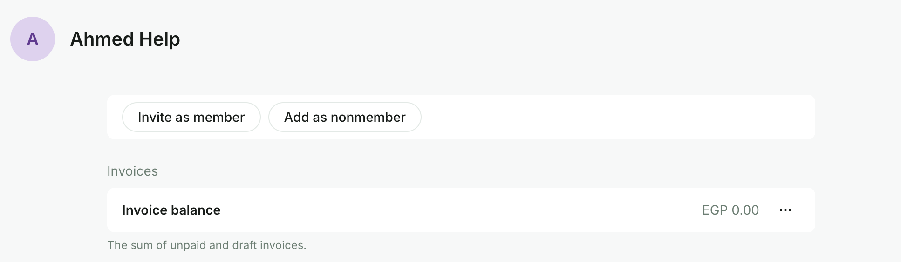

## Set up plan sign-up requests to collect membership applications and verify customers

With sign-up requests, users can apply for membership plans, and you can vet them before creating a subscription.

Plan sign-up requests are ideal for:

- Niche or curated spaces that require personal or professional verification
- Verification-based plans that require ID uploads or supporting documents
- Discounted plans for students, nonprofits, or other groups that need eligibility confirmation.

<Info>
  Enable **Request** on each plan that needs administrator review before a subscription is created. Submitting a request does not create a paid subscription.
</Info>

<Tip>
  For plans that don't require verification, [use the **Immediate** sign-up type](/admin/billing/plans/immediate-plan-sign-ups) instead.
</Tip>

## Configure plan sign-up requests

1. Go to **Catalog** > **Memberships**, [create or edit a membership](/admin/billing/plans/set-up-plans), and open the relevant plan under **Plans**.
2. Enable **Sign-up**.
3. Select **Request** as the sign-up **Type**.

<Frame>
  
</Frame>

4. [Enable the **Support** page](/admin/support/tickets) and set it to **Public** visibility so users can see administrators’ replies.

<Warning>
  If the **Support** page is disabled, the `Apply` button will be greyed out on plans. If the **Support** page is not set to **Public** visibility, users can apply for plans but won’t see administrator responses.
</Warning>

## How users apply for a plan

1. Customers open the location's membership catalog or a direct plan link.

<Frame>
  
</Frame>

2. Select a plan, set their preferred subscription start date, renewal, quantity, and whether they want to sign up as an individual member or as a business.
3. Press `Apply` to submit their request.

<Frame>
  
</Frame>

## How administrators manage plan sign-up requests

1. Each plan sign-up request appears as a new ticket in **Support** \> **Tickets**.
2. Administrators manage the request through the support ticket:

<Frame>
  
</Frame>

- Communicate with the applicant
- Request verification documents
- Ask follow-up questions

3. If the user is approved, click the user’s name in the ticket and press `Invite as member`.

<Frame>
  
</Frame>

4. [Create a subscription](/admin/billing/subscriptions/set-up-subscriptions) for the requested plan for the customer.
5. If the user requested a company subscription, [create a company](/admin/customer-management/companies/set-up-companies) first \> [add this user to the company](/admin/customer-management/companies/company-members-and-managers) as a manager \> create a company subscription.

<Frame>
  
</Frame>

<Tip>
  To avoid missing any notifications about plan sign-up requests, [enable notifications](/admin/administration/your-account/notifications/set-up-notifications) about new support tickets.
</Tip>

## FAQs

<AccordionGroup>
  <Accordion title="How do I add a customer who applied for a booking or subscription as a member or nonmember?">
    A new membership applicant may not appear in the member or nonmember lists until you add them. Open their profile from the support ticket and choose the appropriate customer status.

    1. Click the user’s name from the support ticket to open their profile.
    2. Click `Invite as member` or `Add as nonmember` at the top right.

    <Frame>
      
    </Frame>
  </Accordion>

  <Accordion title="Where does the customer follow their request?">
    The conversation and administrator replies are in the **Support** ticket. Set the Support page to **Public** so an applicant who is not yet a member can access replies.
  </Accordion>

  <Accordion title="Does submitting a request create a company or subscription?">
    No. The request records the plan, start date, renewal, quantity, and business name if supplied. After review, the administrator creates a company when needed, sets up the customer's membership, and creates the appropriate subscription.
  </Accordion>
</AccordionGroup>
