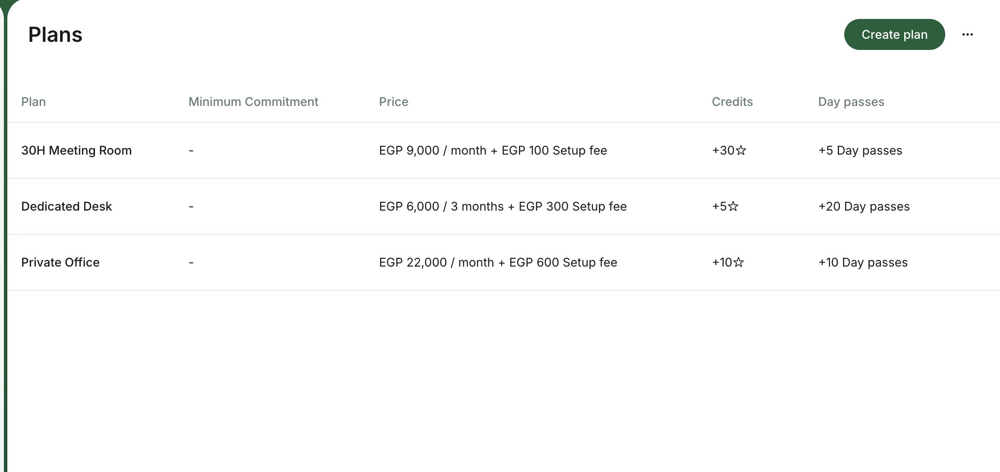
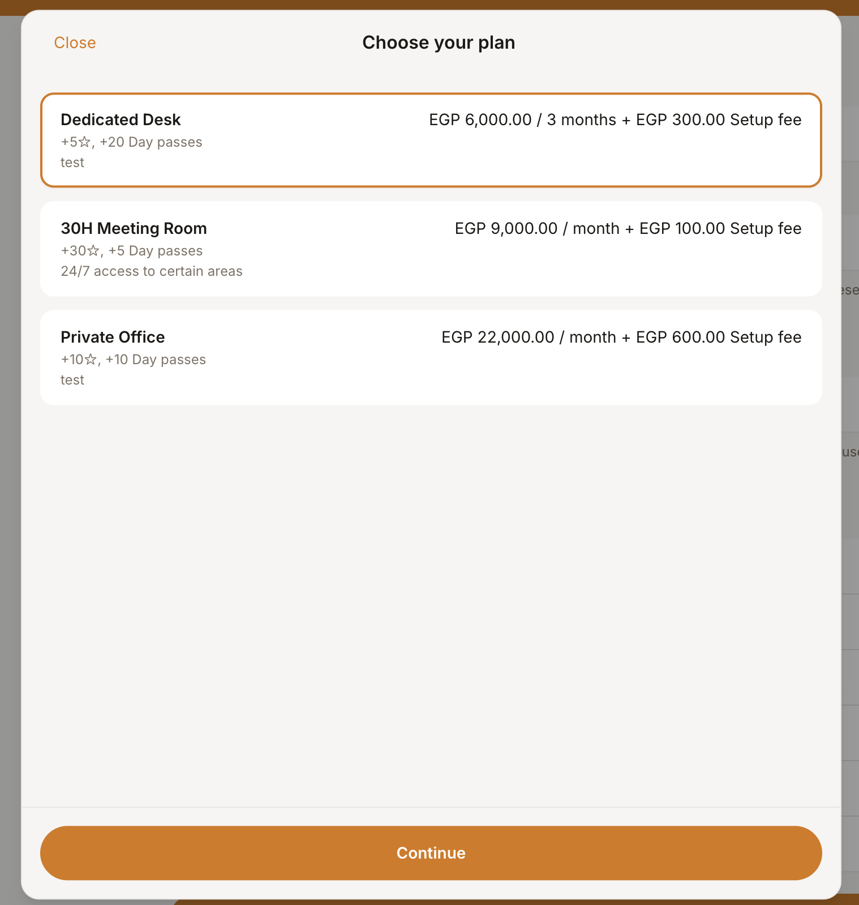
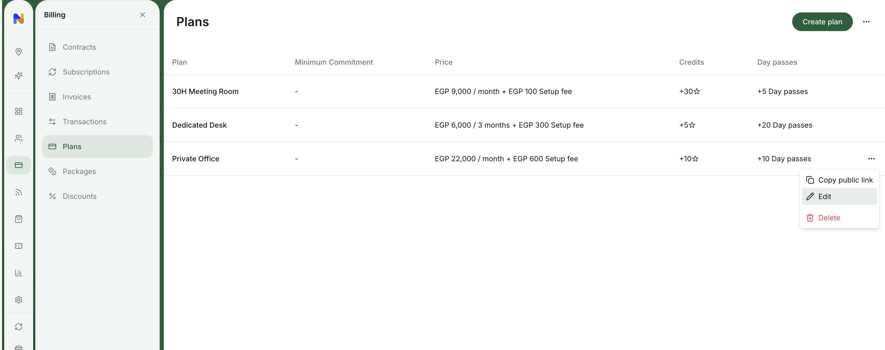
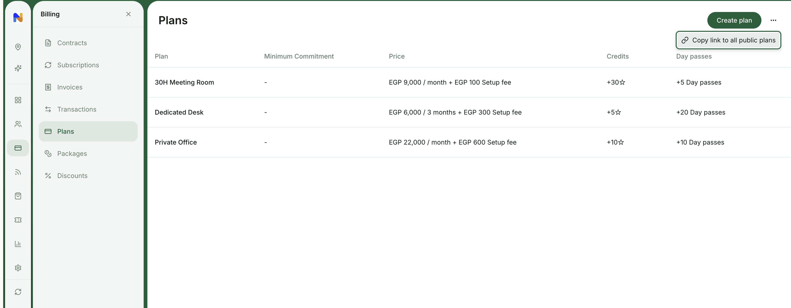

Create and manage membership plans for long-term or recurring access without a dedicated resource rental

Memberships are recurring access options or bundles of services, such as Hot desk unlimited, Hot desk (10 days), or Flex membership. Each membership contains one or more plans, such as Monthly and Yearly, with their own prices, billing cycles, and allowances.

With memberships, you can:

- Structure and present your membership options to customers
- Let customers sign up instantly or submit applications
- Quickly set up new customers for subscriptions, using plans as templates.

## Set up plans

1. Go to **Catalog** > **Memberships**.
2. Click **Create membership**.
3. Enter the membership name and description, and add its photos and exclusive access settings as needed.
4. Under **Plans**, click **Add Plan** and configure a plan using the settings below. Add a plan for each billing option you offer.

<Frame>
  
</Frame>

### Plan configuration

- **Name** — appears on customer invoices.
- **Cycle** — the interval of plan validity and how often the subscription renews. Available options: 1 week, 1 month, 3 months, 6 months, or 1 year.
- **Description** — customer-facing details of what is included.
- **Price** — the fee for 1 cycle.
- **Setup fee** — one-time charge to add to the customer’s first invoice.

<Info>
  The setup fee is taxable but is not affected by discounts or invoice proration.
</Info>

- [**Custom tax rate**](/admin/billing/taxes/custom-tax-rates) — overrides the location’s default tax rate for this plan.
- **Minimum commitment** — the mandatory minimum number of cycles a customer can subscribe for.
- [**Credits**](/admin/billing/credits-and-day-passes/credits) — expiring credits the customer will receive each cycle for bookings or purchases.
- [**Day passes**](/admin/billing/credits-and-day-passes/day-passes) — expiring day passes the customer will receive each cycle for booking hot desks.
- [**Discounts**](/admin/billing/discounts/apply-discounts-to-bookings-and-purchases) — offer discounts on certain services to members subscribed to this plan.
- **Sign-up** — control whether and how customers can see and sign up for this plan.

### Sign-up setting

| Setting | Outcome |
| --- | --- |
| Enable with **Immediate** type | Customers can see this plan and [sign up immediately](/admin/billing/plans/immediate-plan-sign-ups#how-users-sign-up-for-plans) without admin involvement. |
| Enable with **Request** type | Customers can see this plan and [submit a request](/admin/billing/plans/applications-for-plans#how-users-apply-for-a-plan) to sign up. Administrators process requests as support tickets. Useful if you don’t allow new customers to become your members independently. |
| Disable **Sign-up** | The plan should remain visible only for administrators for [creating subscriptions](/admin/billing/subscriptions/set-up-subscriptions). |

- [**Access**](/admin/integrations/access-control) — configure the door access group on a saved plan when a connected integration is available.

<Info>
  Configure exclusive resources and benefits in the shared membership window.
</Info>

5. Save the plan, then click **Save** in the membership window to save the membership and its plans.

<Info>
  Plans are designed for access without a dedicated resource. Dedicated desks, offices, or other rentals — whether long-term, recurring, or hourly or daily access — are configured in [Resources](/admin/resource-management/resources/set-up-pricing).
</Info>

## What’s next

After creating your memberships:

- Customers can explore available plans and [sign up](/admin/billing/plans/immediate-plan-sign-ups) or [submit requests](/admin/billing/plans/applications-for-plans), depending on your settings.

<Frame>
  
</Frame>

- Administrators can quickly [set up new members for subscriptions](/admin/billing/subscriptions/set-up-subscriptions), using plans as ready-made templates with predefined pricing, benefits, and access.

## Edit or delete a plan

1. Go to **Catalog** > **Memberships**.
2. Open the menu **(...)** next to the membership and select **Edit**.
3. Under **Plans**, select the plan to edit it, or use its menu to delete it.
4. Click **Save** to save your changes.

To delete the whole membership, use **Delete** in its row menu.

<Frame>
  
</Frame>

<Info>
  RNTOR prevents deleting a membership or removing a plan when existing billing or rental records still reference it.
</Info>

<Warning>
  To stop new customer sign-ups, [disable **Sign-up**](/admin/billing/plans/set-up-plans) for the membership's plans. This keeps the plans available to administrators when creating subscriptions.
</Warning>

## Filter and export memberships

Use the **Sign-up** filter to find memberships with an **Immediate**, **Request**, or **Off** plan. A membership matches when at least one of its plans matches the filter.

Open the page menu and choose **Export**, then CSV or XLSX, to download the displayed memberships. The export contains one row per plan. You can also select memberships for bulk sign-up changes, export, or deletion. Deletion restrictions still apply to plans referenced by existing records.

## FAQs

<AccordionGroup>
  <Accordion title="How to create a custom plan for one customer?">
    Start [creating the subscription](/admin/billing/subscriptions/set-up-subscriptions) for your customer, keep **Custom** in the **Product** field, and manually type the plan name, price, and other allowances.
  </Accordion>

  <Accordion title="How can I copy the link to all public memberships?">
    Go to **Catalog** > **Memberships** > press the menu `...` top right > **Copy link to all public memberships**.

    <Frame>
      
    </Frame>
  </Accordion>

  <Accordion title="Can I offer discounts for plans?">
    To offer targeted discounts on specific plans or for selected customers, create [coupons and promo codes](/admin/billing/discounts/apply-discounts-to-bookings-and-purchases#create-promo-codes) of **Subscription items** type.

    [Apply them](/admin/billing/discounts/apply-discounts-to-bookings-and-purchases) directly when creating subscriptions for users and companies, or share the [promo code](/admin/billing/discounts/apply-discounts-to-bookings-and-purchases#create-promo-codes) with customers to redeem the discount on their own when they sign up.
  </Accordion>

  <Accordion title="How to offer a package of hours for booking rooms?">
    You can use any of the following options:

    - [**Create a membership plan with credits**](/admin/billing/plans/set-up-plans): This is ideal for recurring packages. Customers subscribe to a plan and automatically receive a set number of expiring credits each cycle to use for bookings.
    - [**Create a credit package**](/admin/billing/credits-and-day-passes/packages): This is best for one-off purchases. Customers can buy a one-off package of credits at any time and use them for bookings.
  </Accordion>

  <Accordion title="Do changes to the plan affect existing members' subscriptions?">
    Changes to the plan only apply to new future subscriptions and those existing members that have **Auto-update from plan** enabled in their subscription.

    To apply plan changes to existing members, you have two options:

    - [**Edit their subscriptions**](/admin/billing/subscriptions/edit-a-subscription) individually and apply changes manually, or
    - Turn on **Auto-update from plan** in existing customers’ subscriptions, then make a change to the plan. This way, it will automatically apply to existing members, too.
  </Accordion>

  <Accordion title="How do I raise a plan's price for existing subscribers?">
    Review the linked subscription items and decide whether to use **Auto-update from plan** or [edit subscriptions manually](/admin/billing/subscriptions/edit-a-subscription). Save the new price, then review each subscription and its upcoming invoice before communicating the amount due. Changing a plan price does not establish that an already issued invoice has changed.
  </Accordion>

  <Accordion title="Why is a plan missing from the customer catalog?">
    Open the membership and its plan, then check that **Sign-up** is enabled with **Immediate** or **Request** selected. A plan with sign-up switched off remains available to administrators when creating subscriptions. Immediate sign-up also requires a price greater than zero.
  </Accordion>

  <Accordion title="Can I change a saved plan's billing cycle?">
    The **Cycle** field is locked after the plan is saved. Add a new plan with the required cycle, and review existing customer subscriptions separately before moving customers to another option.
  </Accordion>
</AccordionGroup>
