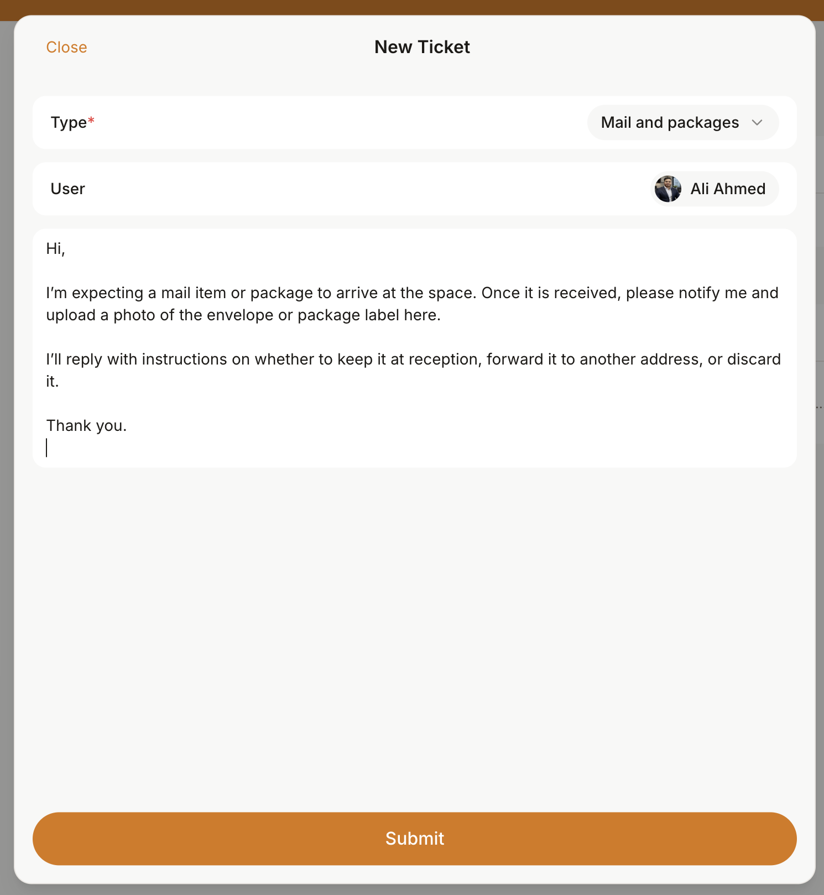
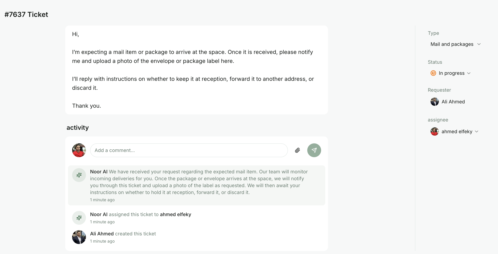

Offer a virtual office membership with a business address and mail handling. Use membership requests when customers need review, and record incoming mail and parcels in **Deliveries**.

## Create a virtual office plan

Automate your virtual office subscriptions and invoicing by creating a dedicated plan:

1. Navigate to **Catalog > Memberships** and click [Create membership](/admin/billing/plans/set-up-plans).
2. Enter the membership name, such as Virtual Office Gold, and describe the included services.
3. Under **Plans**, click **Add Plan**, then set the plan name, price, and billing cycle.
3. When creating the plan, toggle the [**Sign-up** switch](/admin/billing/plans/set-up-plans) on and select the desired sign-up type.

As a result, customers will either [sign up for this plan](/admin/billing/plans/immediate-plan-sign-ups) by themselves immediately or [apply for it](/admin/billing/plans/applications-for-plans), and you will receive the applications on the **Support > Tickets** page.

## Handle deliveries

1. When mail or a parcel arrives, go to **Front desk** > **Deliveries**.
2. Click **Add delivery** and select the recipient user or company.
3. Add a comment describing what arrived and where to collect it.

<Frame>
  
</Frame>

4. Add envelope or parcel photos in **Photos**, then click **Create**.

<Frame>
  
</Frame>

5. The recipient can open pending delivery details in the member portal.
6. After handing over the mail or parcel, open the record menu and choose **Mark picked up**. Use the status, customer, and date filters to find records later.

## FAQs

<Accordion title="How do I request verification documents before accepting a member?">
  Set the virtual office plan's sign-up type to **Request**, then communicate with the applicant through the support ticket before creating a subscription.
</Accordion>

<Accordion title="Does a virtual office membership grant door access?">
  Review **Access** on the saved plan and the connected integration before granting access. Including a mailing address in a membership does not itself determine door permissions.
</Accordion>
