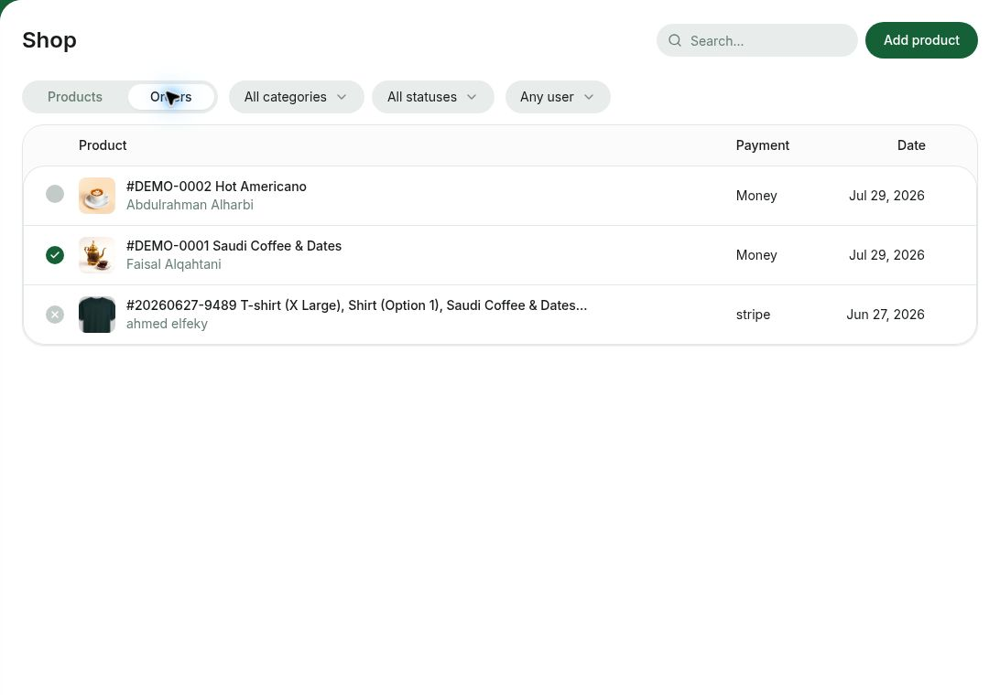
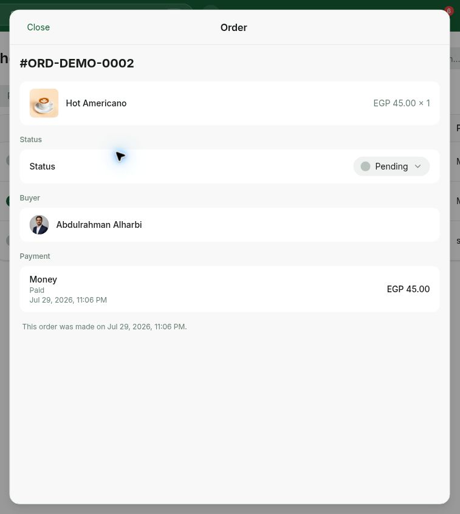
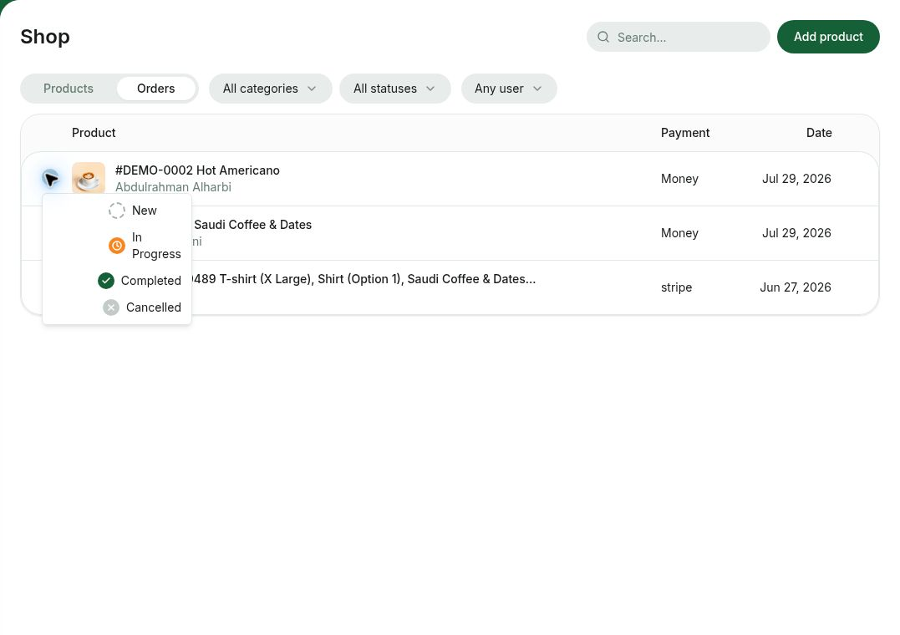
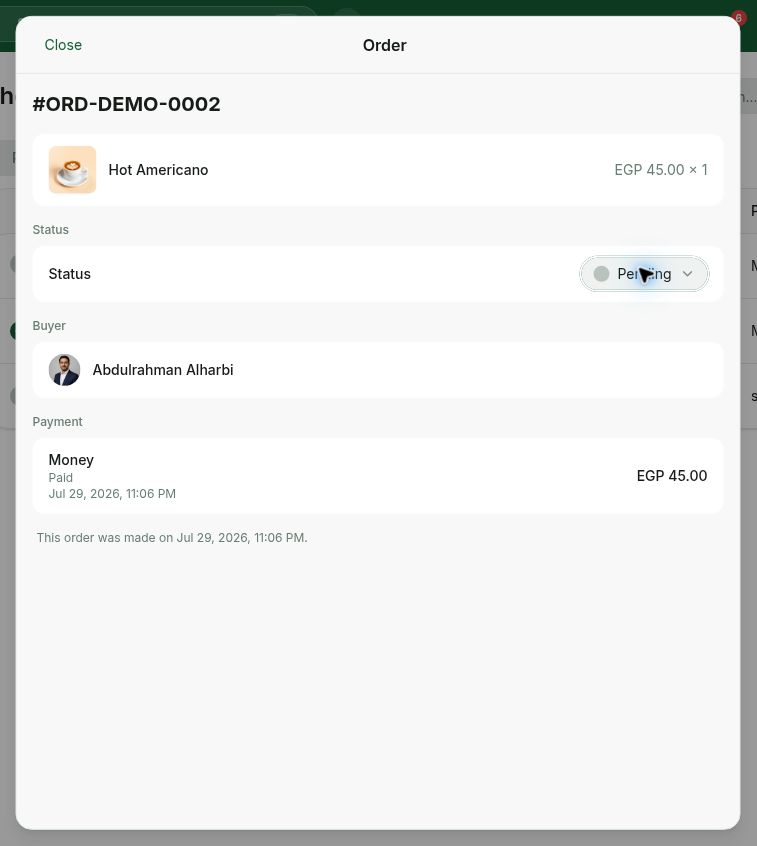
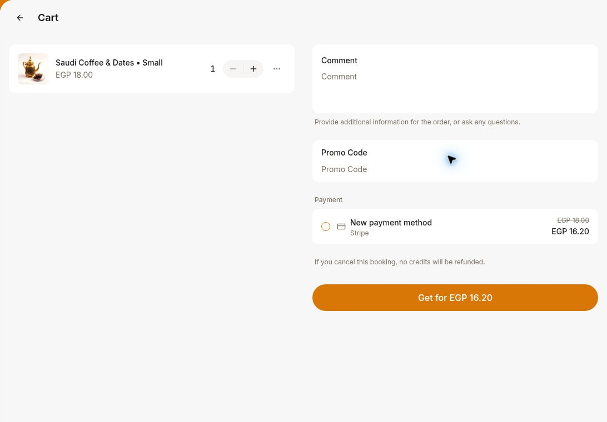

Administrators can track order revenue and manage orders by modifying their status and conducting a search for them.

When the order is created, it appears on the **Catalog** > **Products** page > **Orders** tab. Orders are sorted from newest to oldest.

## Create an order for a customer

1. Open **Catalog** > **Products** and click **Create order**.
2. Select the customer. Use **New nonmember** in the customer picker if they do not yet have a customer record.
3. Add products, options, and quantities, then enter a comment if needed.
4. Select **Free** or **External** from the payment choices shown. For an external payment, choose **Paid** only after confirming that you received the money; otherwise leave it **Pending**.
5. Review the total, tax, and availability, then click **Create order**. If the price changes, review the refreshed amount before confirming.

## Manage orders

Once [a customer places an order](/member/shop), open it from the **Orders** tab to view its details:

| **Value**    | **Description**                                                                                                                                                                                                                                                                                                                                                                                       |
| :----------- | :---------------------------------------------------------------------------------------------------------------------------------------------------------------------------------------------------------------------------------------------------------------------------------------------------------------------------------------------------------------------------------------------------- |
| Order number | Every order has a unique number within a location (e.g., #30).                                                                                                                                                                                                                                                                                                                                        |
| Option       | The variation of the product.                                                                                                                                                                                                                                                                                                                                                                         |
| Quantity     | The quantity of the ordered product options.                                                                                                                                                                                                                                                                                                                                                          |
| Status | Distinguish payment progress from fulfillment: **Pending** awaits payment completion; **New**, **In progress**, and **Completed** describe fulfillment; **Canceled** identifies a canceled order. Review payment details before preparing the order. |
| Buyer        | The customer who placed the order.                                                                                                                                                                                                                                                                                                                                                                    |
| Payment      | The payment method the customer chose.                                                                                                                                                                                                                                                                                                                                                                |

<Tip>
  [Configure the notifications](/admin/administration/your-account/notifications/set-up-notifications) to be instantly notified about new shop orders.
</Tip>

### Find and filter orders

Filter orders on the **Orders** tab to find what you need:

* Filter by **Status** to see **New**, **In progress**, **Completed**, or **Canceled** orders.
* Filter by **Category** to see orders from a specific shop category.
* Filter by **Product** to see orders that include a specific product.
* Filter by **User** to see all orders of a specific customer.
* Filter by **Create date** to see orders created on, before, after, or between specific dates.

### Change an order's status

Only administrators can change an order's status. Click the **Status** icon next to the order — or open the order and use the **Status** field — and choose the new status. The customer receives [a push notification](/member/account/notifications) when their order status changes.

### Cancel an order and issue a refund

Open the order and use its available cancellation action, then review the confirmation and refund eligibility. If a refund choice is shown, select it according to the product policy. After cancellation, check the refund outcome in the transaction or invoice; **Canceled** alone does not mean the money was returned. Confirmation may remain pending while payment is reconciled. [Understand refunds](/admin/billing/payments/refunds).

## View order status

Users can view the status of their order by following these steps:

1. Click on their profile picture in the bottom left corner to open the **Account** page.
2. Go to the **Orders** section to view the status of their orders.

## Check analytics on order statuses

Get a consolidated overview of all orders with the specific status on the **Analytics** page.

1. Open the **Analytics** page > choose **Shop** dashboard.
2. Check the **Orders by status** graph and choose the specific time periods for the overview.

## Export orders

Apply the required filters, open the page menu, and choose **Export orders data** to download a CSV. Check the period and filters before using the file; it reflects the filtered order list.

## FAQs

<Accordion title="What does a pending order mean?">
  Payment has not yet been confirmed. Open payment details and check the transaction before preparing the order. For an external payment, verify receipt before recording it as paid.
</Accordion>

<Accordion title="Does canceling an order refund it immediately?">
  Do not rely on the order status alone. The outcome depends on the payment method, refund policy, and transaction state. Check the transaction or invoice for the actual refund amount and status.
</Accordion>

<Accordion title="How do I avoid duplicate orders when a request is slow?">
  Check existing orders and the current attempt's outcome before starting another order. If the outcome cannot be confirmed, retain the transaction details for review.
</Accordion>
