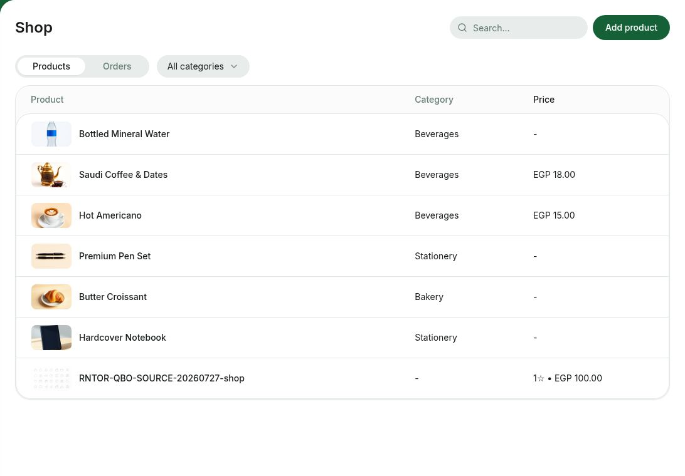
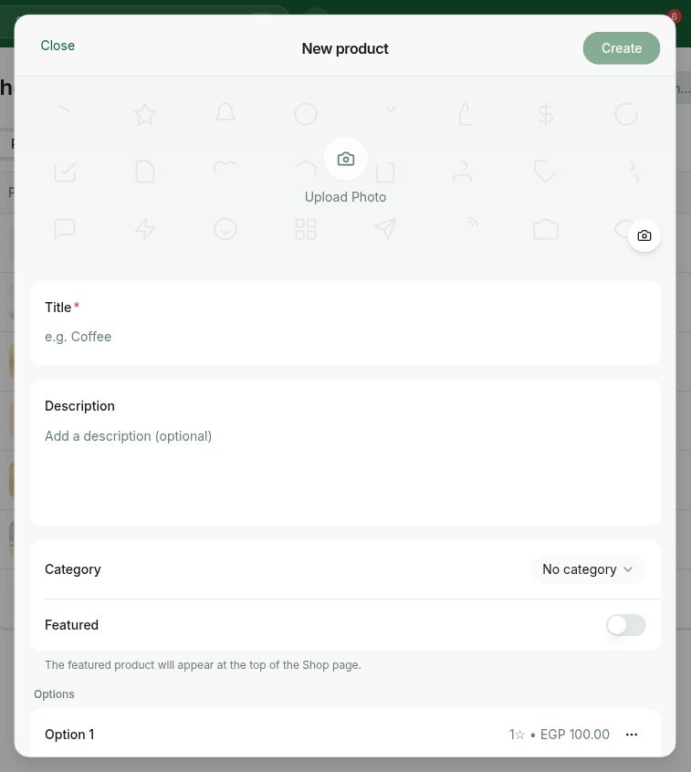
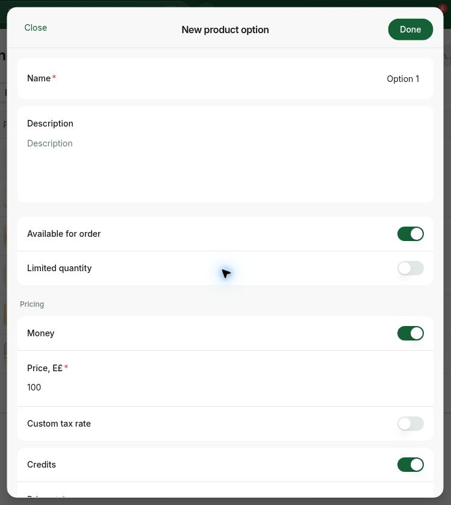
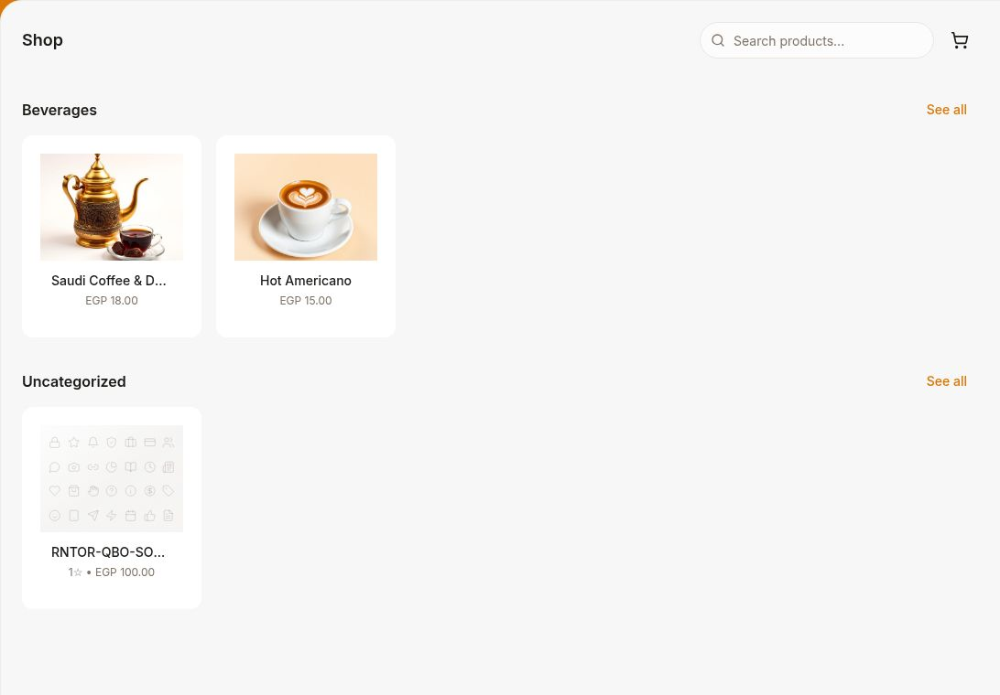
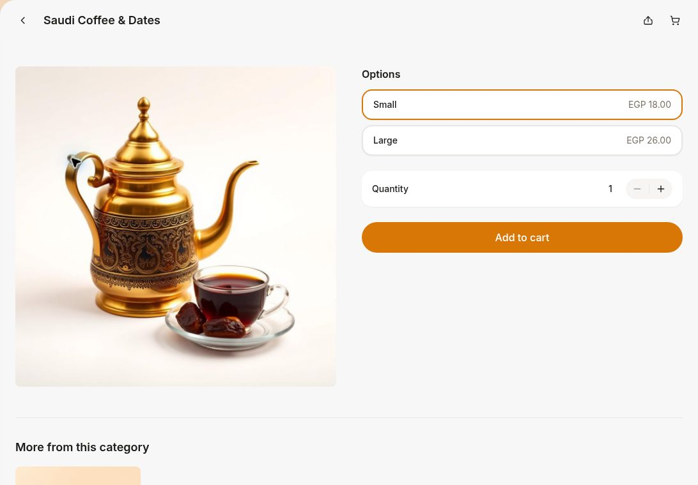
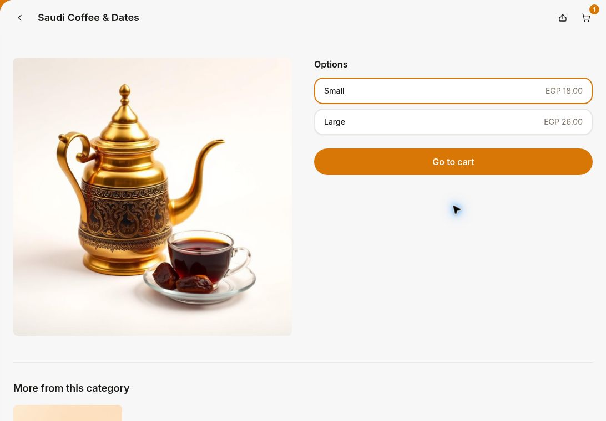

Sell additional services, such as food or merch, to your customers.

## Enable Shop

1. Click the menu **(...)** near the location name on the left-side panel.
2. Go to **Location settings** > **Catalog**.
3. Enable the **Shop** switch.
4. Create product categories to group your products by type. For example, **Cafe**, **Merch**, **Services**, etc.

<Info>
  New categories are added to the end of the list. Drag and drop categories to set their display order.
</Info>

5. Enable the **Order confirmation email** switch and [customize your confirmation email](/admin/general/customize-emails) template.

<Info>
  When order confirmation emails are enabled, configure their text in Catalog settings. You can enter English and Arabic versions.
</Info>

## Add products

1. Go to **Catalog** > **Products** > press **Add product** in the top right corner.

2. Configure the product details:

| **Product property** | **Meaning**                                                                                                                                                                                                                                                                                                                                                                                                                                                                                                                                                                                                                                                                                                                                                                                                                                                                                                                                                                                                                                                              |
| :------------------- | :----------------------------------------------------------------------------------------------------------------------------------------------------------------------------------------------------------------------------------------------------------------------------------------------------------------------------------------------------------------------------------------------------------------------------------------------------------------------------------------------------------------------------------------------------------------------------------------------------------------------------------------------------------------------------------------------------------------------------------------------------------------------------------------------------------------------------------------------------------------------------------------------------------------------------------------------------------------------------------------------------------------------------------------------------------------------- |
| Cover photo          | A picture with a 2x1 ratio.                                                                                                                                                                                                                                                                                                                                                                                                                                                                                                                                                                                                                                                                                                                                                                                                                                                                                                                                                                                                                                              |
| Title                | The title of the product.                                                                                                                                                                                                                                                                                                                                                                                                                                                                                                                                                                                                                                                                                                                                                                                                                                                                                                                                                                                                                                                |
| Description          | Details you’d like users to know when ordering.                                                                                                                                                                                                                                                                                                                                                                                                                                                                                                                                                                                                                                                                                                                                                                                                                                                                                                                                                                                                                          |
| Category             | Select which category the product belongs to.                                                                                                                                                                                                                                                                                                                                                                                                                                                                                                                                                                                                                                                                                                                                                                                                                                                                                                                                                                                                                            |
| Featured             | If enabled, the product will be prominently pinned at the top of the **Shop** page.                                                                                                                                                                                                                                                                                                                                                                                                                                                                                                                                                                                                                                                                                                                                                                                                                                                                                                                                                                                      |
| Options              | Add variations for the product. For example, if you're selling a branded T-shirt, your options might be different sizes and colors. If you're selling coffee, options could include **Latte** or "Americano." For each product option set: <ul><li>**Name** — the name of the product.</li><li>**Description** — extra details about this specific option.</li><li>**Available for order** — toggle this on to make the option available for order. If it's turned off, the option will appear as greyed out and unavailable.</li><li>**Limited quantity** — if you have a limited number of items in stock, enable this option and enter the available quantity. The system will automatically show this option as **Out of stock** once this number of items is ordered. [<u>Manage shop product availability</u>](/admin/service/shop/set-up-shop#manage-product-availability)</li><li>**Pricing** — set price in money and/or credits per item and set a [<u>custom tax rate</u>](/admin/billing/taxes/custom-tax-rates), if it's different from your location's default tax rate.</li></ul> |
| Order                | <ul><li>**Enabled** — enables the **Order** button, allowing users to place orders for this product.</li><li>**Disabled** — lets users read the product description but not submit an order.</li></ul>                                                                                                                                                                                                                                                                                                                                                                                                                                                                                                                                                                                                                                                                                                                                                                                                                                                                   |
| Refund policy | Choose **No refund** or **Only if new**. Review the order's eligibility and refund outcome when canceling; a status change alone does not prove that money was returned. |
| Visibility           | Manage access to the product by making it visible to administrators, location members, network members, or the public.                                                                                                                                                                                                                                                                                                                                                                                                                                                                                                                                                                                                                                                                                                                                                                                                                                                                                                                                                   |

<Tip>
  [Bulk create shop products](/admin/noor-ai/bulk-create-resources-products-events-and-benefits) with the RNTOR assistant.
</Tip>

## How Shop works

* Customers can explore and purchase products on the **Shop** page. Understand [how users order products.](/member/shop)
* Administrators can also [add any shop product as an item to a customer's invoice, contract, or subscription.](/guides/revenue-and-space-optimization/recurring-add-ons)
* Use the **Promote** feature to create a feed post about the product and attract more customer attention to it. It's a great way to announce new products available in your space or re-engage interest in existing ones.

## Manage product availability

You can flexibly control and update the availability and quantity of your shop products and product options for orders.

### Set **Limited quantity**

Setting **Limited quantity** is ideal for products like merchandise, where you have a specific number of items in stock.

1. Go to the **Catalog** > **Products** page.
2. [Create](/admin/service/shop/set-up-shop) or [edit](/admin/service/shop/set-up-shop#edit-or-delete-a-product) a shop product.
3. Open a specific product option within the product.
4. Enable the **Limited quantity** switch and enter the number of units you have available.

<Info>
  The **Limited quantity** option only appears when the **Available for order** switch is turned on for this product option.
</Info>

**How it works**

* The system will automatically track sales for this product option and update its availability.
* When only 2 or 1 item is left from the quantity you set, a badge will appear for users indicating "2 Left" or "1 Left."
* When the entire stock quantity has been purchased, the product option will show an **Out of stock** badge.

* You can restock a product option at any time by [editing its quantity](/admin/service/shop/set-up-shop#edit-or-delete-a-product), and users will be able to continue ordering it.

### Disable orders for a certain product option

If a particular product option (like a specific salad variation) is temporarily unavailable, you can disable just that option within the product at any time.

1. Go to the **Catalog** > **Products** page.
2. [Create](/admin/service/shop/set-up-shop) or [edit](/admin/service/shop/set-up-shop#edit-or-delete-a-product) a shop product.
3. Open a specific product option within the product.
4. Disable the **Available for order** switch.

The option will appear as greyed out and unavailable for order. All other options for that product will remain available.

### Disable orders for the entire shop product

To temporarily stop selling an entire product, you can disable orders for it.

1. Go to the **Catalog** > **Products** page.
2. [Create](/admin/service/shop/set-up-shop) or [edit](/admin/service/shop/set-up-shop#edit-or-delete-a-product) a shop product.
3. Disable the **Order** switch.

The shop product will still be listed on the **Shop** page, but without the **Order** button. Therefore, users won't be able to purchase it.

<Info>
  You can make the product option or product available for order again at any time.
</Info>

<Info>
  You can also temporarily hide a product from all users by [changing its **Visibility**](/admin/service/shop/set-up-shop#edit-or-delete-a-product) to **Administrators**.
</Info>

## Edit or delete a product

1. Go to **Catalog** > **Products**.
2. Hover over the product > press the menu **(...)** next to it > **Edit** or **Delete**.

<Info>
  After editing a product, review its visibility and options in the member portal. Use **Promote** to share an update in the feed.
</Info>

<Info>
  Review the [refund policy](/admin/billing/payments/refunds) and order details before processing a cancellation or communicating a refund outcome.
</Info>

<Warning>
  Deleting a product is irreversible and can not be undone.
</Warning>

## Edit or delete a product category

1. Go to **Location settings** > **Catalog**.
2. Press the menu **(...)** next to the necessary category > **Edit** or **Delete**.

<Warning>
  Before deleting a category, review its products and move the products you want to keep into another category. Confirm category deletion after reviewing its contents.
</Warning>

## Filter and export products

Use search and the **Category** filter in **Catalog** > **Products**. Open the page menu and choose **Export products data** to download the filtered list as CSV. To delete several products, choose **Select items**, select the products, and review the selection before choosing **Delete**.

## FAQs

<Accordion title="How does disabling orders differ from hiding a product?">
  Turning **Order** off keeps the product details visible without allowing purchases. Setting **Visibility** to **Administrators only** hides the product from customers. To disable a single variation, turn off **Available for order** on that option.
</Accordion>

<Accordion title="How do I restock an option?">
  Open the product and option, check **Available for order** and **Limited quantity**, enter the actual available quantity, and save.
</Accordion>

<Accordion title="Can an administrator create an order for a customer?">
  Yes. Click **Create order** in **Catalog** > **Products** and follow the [order creation steps](/admin/service/shop/manage-orders#create-an-order-for-a-customer).
</Accordion>
