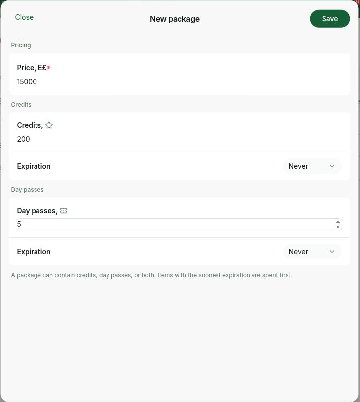
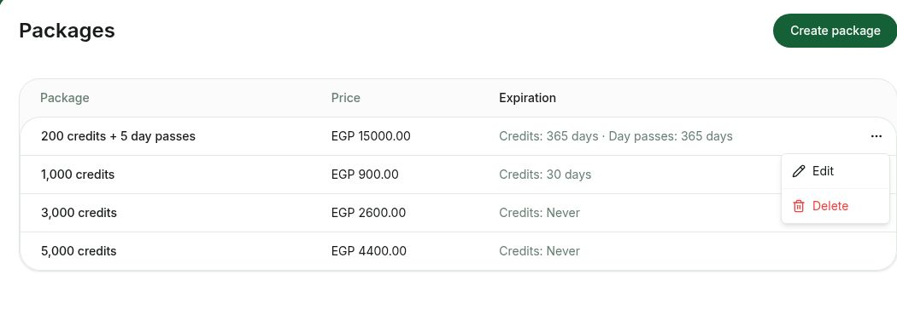

الحزم مجموعات من الأرصدة أو تصاريح اليوم أو كليهما، يمكن للأعضاء شراؤها واستخدامها للحجوزات وطلبات المتجر وتذاكر الفعاليات.

استخدم الحزم من أجل:

- بيع مجموعات أرصدة أو تصاريح يوم لمرة واحدة للأعضاء الذين يحتاجون إلى وصول عرضي بدلًا من خطة متكررة.
- تمكين الأعضاء من شراء المزيد عندما تنفد الأرصدة أو تصاريح اليوم المضمنة في اشتراكهم.
- إنشاء حزم بفترات صلاحية مخصصة أو حزم لا تنتهي صلاحيتها.
- تشجيع الدفع بالأرصدة، مما يقلل عدد المعاملات الصغيرة ورسوم معالجة المدفوعات.

## إنشاء الحزم

1. انتقل إلى **الكتالوج** > **الباقات**.
2. اضغط على **إنشاء باقة**.
3. أدخل سعر الحزمة.
4. أدخل عدد الأرصدة أو تصاريح اليوم، أو أدخل الاثنين معًا لإنشاء حزمة مختلطة.
5. اضبط انتهاء الصلاحية لكل من الأرصدة وتصاريح اليوم بصورة مستقلة. عطّل **انتهاء الصلاحية** إذا أردتها بلا انتهاء، أو فعّله وأدخل **الأيام بعد الشراء** من 1 إلى 3650 يومًا.
6. اضغط على **حفظ**.

<Frame>
  
</Frame>

## كيفية شراء الأعضاء للحزم

1. يشتري الأعضاء الحزم من صفحتي **العضوية** \> **الأرصدة** و**تصاريح اليوم**.
   - الأعضاء الأفراد — ضمن قسم **شخصي**.
   - مديرو الشركات وأعضاؤها — ضمن قسم الشركة.
   <Frame>
   </Frame>
2. أكمل الشراء بطريقة الدفع المتاحة، ثم راجع إضافة الأرصدة أو تصاريح اليوم في الرصيد وسجل المعاملات. لا تُعد شاشة الدفع المعلّق تأكيدًا على إضافة الباقة. وتُستخدم المخصصات حتى تاريخ انتهاء كل نوع، إن وُجد.

<Info>
  لا يمكن رؤية الحزم وشراؤها واستخدامها إلا من جانب الأعضاء؛ فهي غير متاحة لغير الأعضاء:

  - [ادعُهم](/ar/admin/customer-management/users/members#invite-a-member) كأعضاء ليتمكنوا من شراء حزمة، أو
  - يمكن لغير الأعضاء [الاشتراك في خطط](/ar/admin/billing/plans/set-up-plans) تتضمن أرصدة وتصاريح يوم بدلًا من ذلك.
</Info>

<Info>
  لا يستطيع أعضاء الشركة من غير المديرين شراء حزم للشركة إلا إذا كانت لديهم [صلاحية](/ar/admin/customer-management/companies/company-payment-method-permissions) استخدام بطاقة الشركة أو فاتورتها لهذا الغرض.
</Info>

## إدارة الحزم

لتعديل حزمة أو حذفها:

1. انتقل إلى **الكتالوج** > **الباقات**.
2. اضغط على **(...)** بجوار الحزمة المطلوبة، ثم اختر **تعديل** أو **حذف**.

<Frame>
  
</Frame>

## أفضل الممارسات

لتشجيع مبيعات الحزم:

- سعّر الحزم الأكبر بقيمة أقل قليلًا من قيمتها النقدية المكافئة، أو
- امنح الأعضاء [خصومات على حزم](/ar/admin/billing/discounts/apply-discounts-to-bookings-and-purchases) الأرصدة وتصاريح اليوم.

يشجع ذلك العملاء على الدفع مقدمًا ويزيد ارتباطهم بمساحتك.

## الأسئلة الشائعة

<Accordion title="أين يرى الأعضاء معاملات شراء الحزم؟">
  - إذا كانت الحزمة قد اشتُريت بالبطاقة، فتظهر في **العضوية** \> **الفوترة** \> **المعاملات**.
  - إذا كانت قد اشتُريت عبر فاتورة، فتظهر في **العضوية** \> **الفوترة** \> **الفاتورة القادمة** أو **الفواتير**.
  - تظهر مشتريات الحزم أيضًا في سجل الأرصدة ضمن **العضوية** \> **الأرصدة/تصاريح اليوم** \> **المعاملات**.
</Accordion>

<Accordion title="أين يمكنني تتبّع مشتريات العملاء لحزم الأرصدة؟">
  - فعّل [الإشعارات](/ar/admin/administration/your-account/notifications/set-up-notifications) الخاصة بشراء الحزم.
  - استخدم علامة تبويب **المدفوعات** في [**التحليلات**](/ar/admin/analytics-reports/dashboards) لمتابعة مبيعات الحزم.
  - أنشئ [تقرير **معاملات** مخصصًا](/ar/admin/analytics-reports/reports)، ثم صفِّه حسب النوع **حزمة**.
</Accordion>

<Accordion title="ما الفرق بين الباقة وخطة العضوية؟">
  الباقة عملية شراء لمرة واحدة من الأرصدة أو تصاريح اليوم، ولا تجدد نفسها تلقائيًا. أما خطة العضوية فتحدد دورة اشتراك ومخصصات متكررة. اختر الباقة لتعبئة إضافية أو استخدام غير منتظم.
</Accordion>

<Accordion title="هل يلزم اشتراك متكرر لشراء باقة؟">
  يلزم أن يكون العميل عضوًا في الموقع وأن تتاح له طريقة الدفع المناسبة. العضوية في الموقع ليست هي نفسها امتلاك خطة اشتراك متكرر.
</Accordion>

<Accordion title="هل يمكن للمسؤول إضافة رصيد دون شراء باقة؟">
  يمكنه [إدارة رصيد الأرصدة](/ar/admin/billing/credits-and-day-passes/manage-credit-balance) أو [رصيد تصاريح اليوم](/ar/admin/billing/credits-and-day-passes/manage-day-pass-balance) من ملف العميل. إضافة الرصيد يدويًا إجراء مختلف عن شراء باقة؛ راجع سبب الإضافة وسجلها.
</Accordion>

<Accordion title="هل يمكن أن تنتهي الأرصدة وتصاريح اليوم في تاريخين مختلفين؟">
  نعم. تضبط صلاحية كل نوع بصورة مستقلة داخل الباقة المختلطة. راجع الإعدادين قبل الحفظ.
</Accordion>
