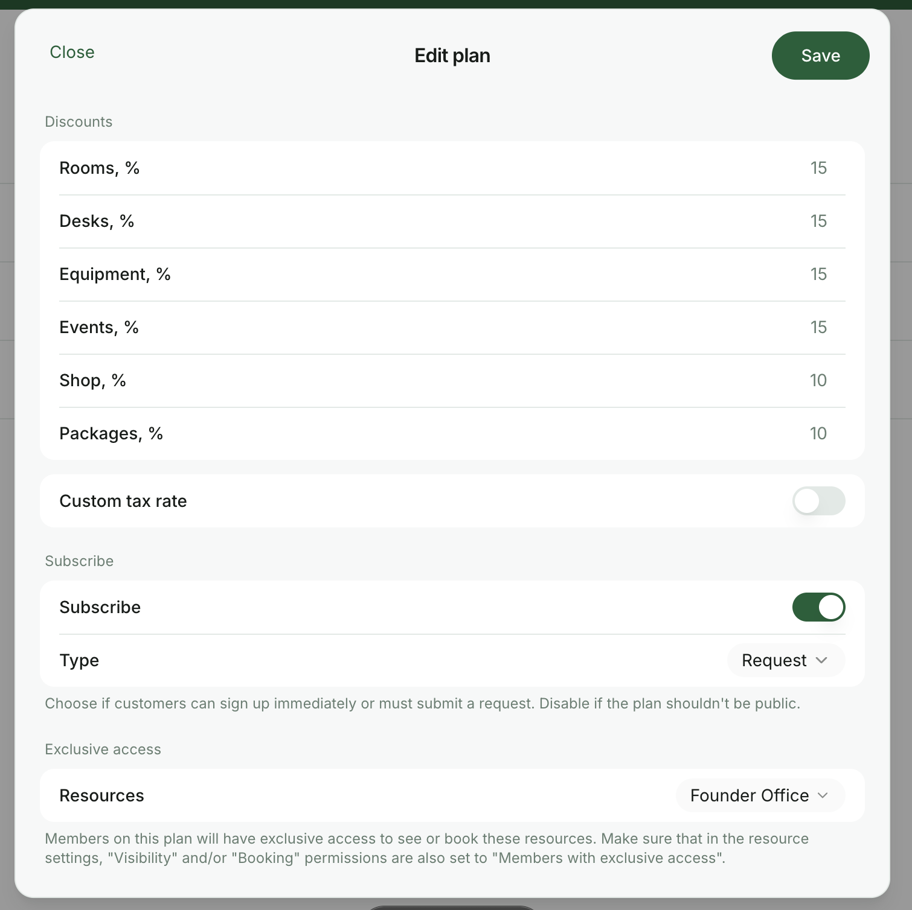
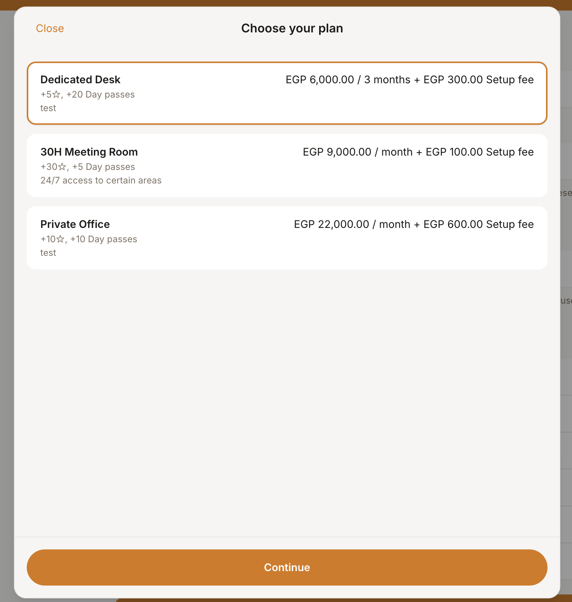
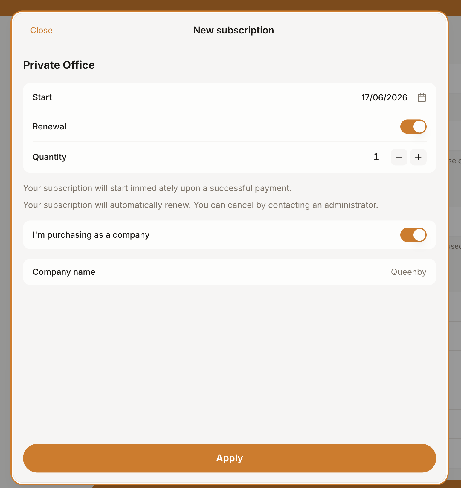
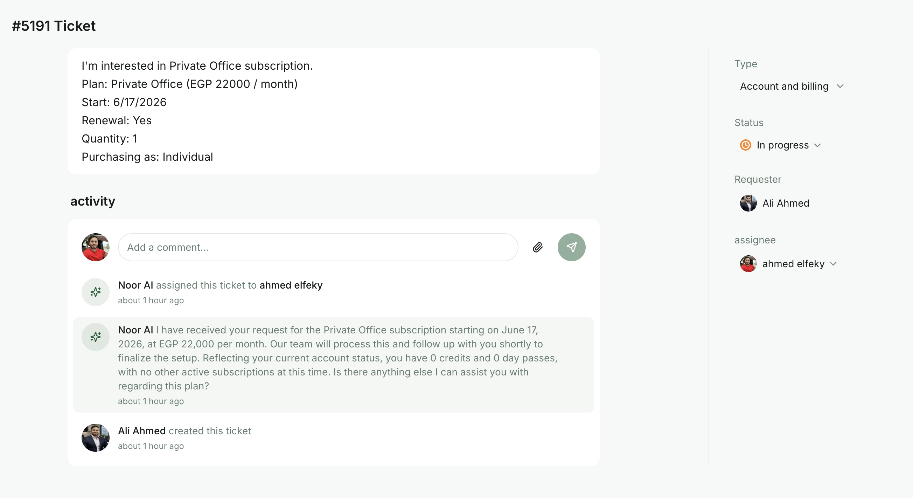
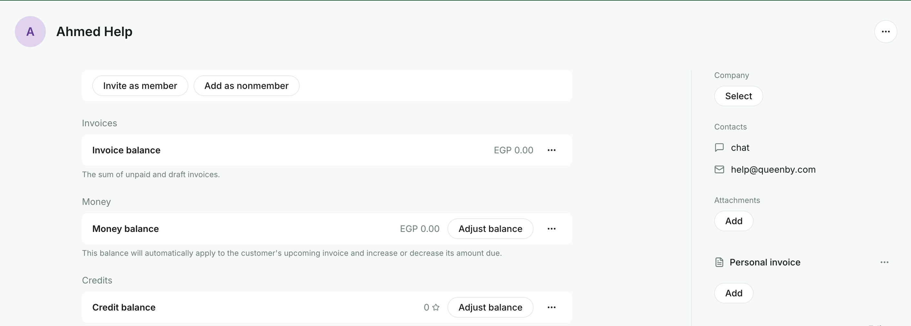
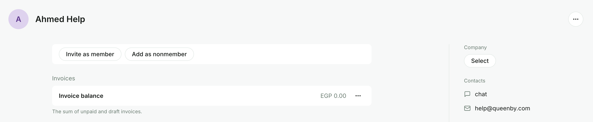
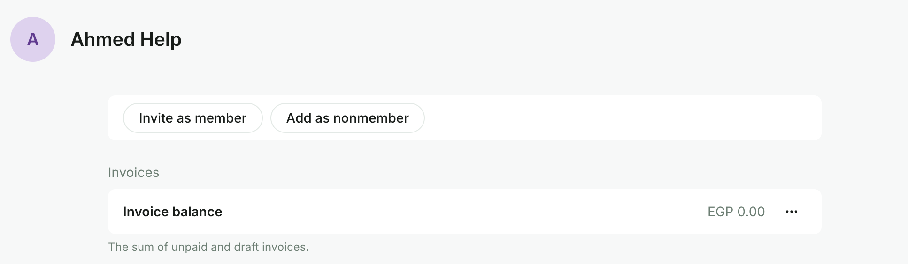

## إعداد طلبات التسجيل في الخطط لجمع طلبات العضوية والتحقق من العملاء

من خلال طلبات التسجيل، يمكن للمستخدمين التقدم بطلب للحصول على خطط العضوية، ويمكنك التحقق منهم قبل إنشاء اشتراك.

تُعد طلبات التسجيل في الخطط مثالية لـ:

- المساحات المتخصصة أو المختارة بعناية والتي تتطلب التحقق الشخصي أو المهني
- الخطط القائمة على التحقق التي تتطلب رفع وثائق هوية أو مستندات داعمة
- الخطط المخفضة للطلاب أو المنظمات غير الربحية أو غيرها من الفئات التي تحتاج إلى تأكيد الأهلية.

<Info>
  فعّل نوع **طلب** في كل خطة تحتاج إلى مراجعتها قبل إنشاء الاشتراك. إرسال الطلب وحده لا ينشئ اشتراكًا مدفوعًا.
</Info>

<Tip>
  بالنسبة للخطط التي لا تتطلب التحقق، [استخدم نوع التسجيل **الفوري**](/ar/admin/billing/plans/immediate-plan-sign-ups) بدلاً من ذلك.
</Tip>

## تكوين طلبات التسجيل في الخطط

1. انتقل إلى **الكتالوج** > **العضويات**، ثم [أنشئ عضوية أو عدّلها](/ar/admin/billing/plans/set-up-plans) وافتح الخطة المطلوبة ضمن **الخطط**.
2. فعّل **التسجيل**.
3. حدد **طلب** بوصفه **نوع** التسجيل.

<Frame>
  
</Frame>

4. [فعّل صفحة **الدعم**](/ar/admin/support/tickets) واضبطها على رؤية **عامة** حتى يتمكن المستخدمون من رؤية ردود المسؤولين.

<Warning>
  إذا تم تعطيل صفحة **الدعم**، فسيظهر زر `Apply` باللون الرمادي على الخطط. وإذا لم تكن صفحة **الدعم** مضبوطة على رؤية **عامة**، فيمكن للمستخدمين التقدم بطلبات للخطط لكنهم لن يروا ردود المسؤولين.
</Warning>

## كيف يتقدم المستخدمون بطلب للحصول على خطة

1. يفتح العملاء كتالوج العضويات للموقع أو الرابط المباشر للخطة.

<Frame>
  
</Frame>

2. يحددون خطة، ويضبطون تاريخ بدء الاشتراك المفضل لديهم، والتجديد، والكمية، وما إذا كانوا يرغبون في التسجيل كعضو فردي أم كعمل تجاري.
3. يضغطون على `Apply` لإرسال طلبهم.

<Frame>
  
</Frame>

## كيف يدير المسؤولون طلبات التسجيل في الخطط

1. يظهر كل طلب تسجيل في خطة على شكل تذكرة جديدة في **الدعم** \> **التذاكر**.
2. يدير المسؤولون الطلب من خلال تذكرة الدعم:

<Frame>
  
</Frame>

- التواصل مع مقدم الطلب
- طلب مستندات التحقق
- طرح أسئلة متابعة

3. إذا تمت الموافقة على المستخدم، فانقر على اسم المستخدم في التذكرة واضغط على `Invite as member`.

<Frame>
  
</Frame>

4. [أنشئ اشتراكًا](/ar/admin/billing/subscriptions/set-up-subscriptions) للخطة المطلوبة للعميل.
5. إذا طلب المستخدم اشتراك شركة، [فأنشئ شركة](/ar/admin/customer-management/companies/set-up-companies) أولاً > [أضف هذا المستخدم إلى الشركة](/ar/admin/customer-management/companies/company-members-and-managers) بوصفه مديرًا > أنشئ اشتراك شركة.

<Frame>
  
</Frame>

<Tip>
  لتجنب تفويت أي إشعارات بشأن طلبات التسجيل في الخطط، [فعّل الإشعارات](/ar/admin/administration/your-account/notifications/set-up-notifications) المتعلقة بتذاكر الدعم الجديدة.
</Tip>

## الأسئلة الشائعة

<AccordionGroup>
  <Accordion title="كيف أضيف عميلاً تقدم بطلب حجز أو اشتراك بوصفه عضوًا أو غير عضو؟">
    قد لا يظهر مقدم طلب العضوية الجديد في قوائم الأعضاء أو غير الأعضاء قبل أن تضيفه. افتح ملف مقدم الطلب من تذكرة الدعم، ثم اختر الحالة المناسبة.

    1. انقر على اسم المستخدم من تذكرة الدعم لفتح ملفه الشخصي.
    2. انقر على `Invite as member` أو `Add as nonmember` في أعلى اليمين.

    <Frame>
      
    </Frame>
  </Accordion>

  <Accordion title="أين يتابع العميل طلب العضوية؟">
    يتابع المحادثة وردود المسؤول من تذكرة **الدعم**. اضبط ظهور صفحة الدعم على **عام** حتى يستطيع مقدم الطلب الذي لم يصبح عضوًا بعد الوصول إلى الردود.
  </Accordion>

  <Accordion title="هل إرسال الطلب ينشئ شركة أو اشتراكًا؟">
    لا. يتضمن الطلب بيانات الخطة وتاريخ البدء والتجديد والكمية واسم الشركة إن أُدخل. بعد المراجعة ينشئ المسؤول الشركة عند الحاجة، ويضبط عضوية العميل، ثم ينشئ الاشتراك المناسب.
  </Accordion>
</AccordionGroup>
