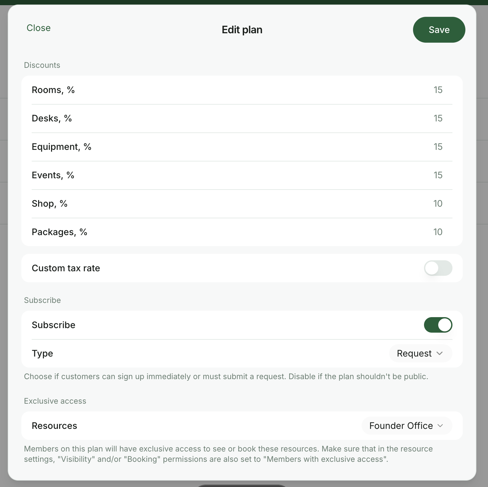
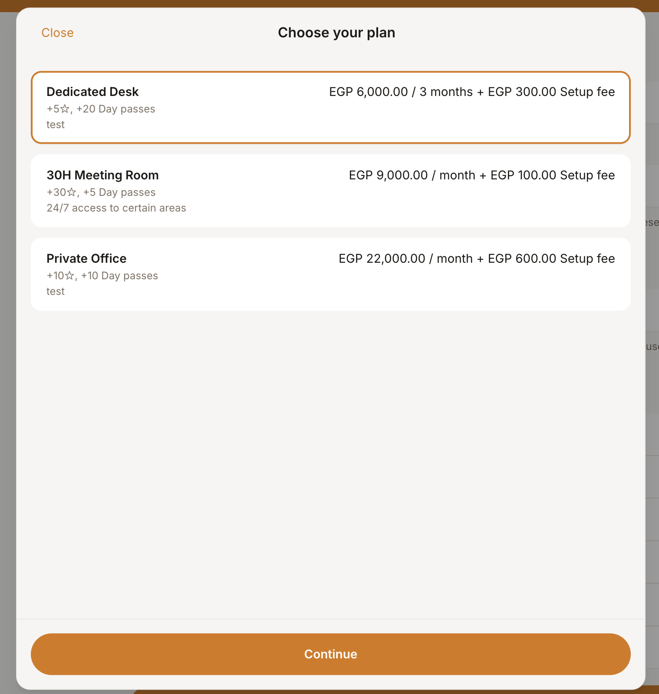
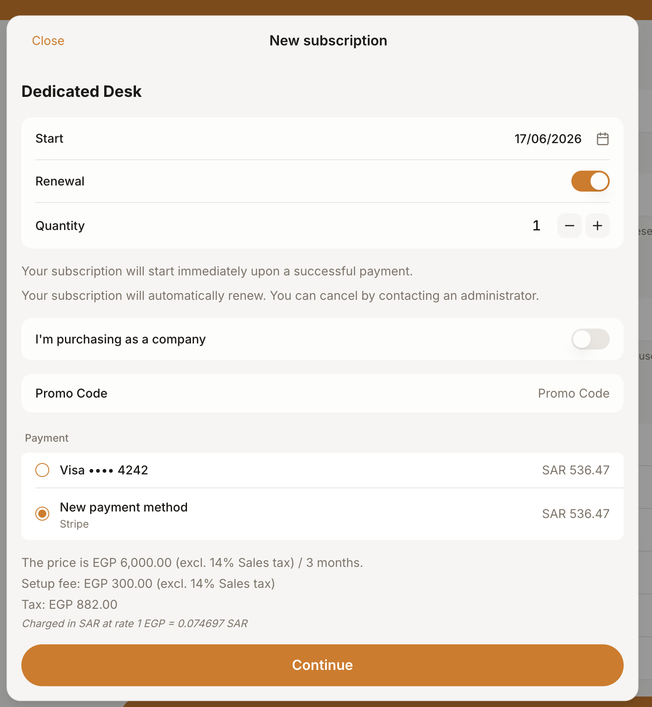

## قم بإعداد الاشتراك الفوري في الخطط للسماح للعملاء بشراء الاشتراكات بشكل مستقل، وافهم تدفق تسجيل المستخدم

يتيح التسجيل الذاتي للمستخدمين الاشتراك في خطط العضوية بأنفسهم، مما يوفر وقتك ويزيد من الإيرادات. هذا الخيار مثالي للخطط التي لا تتطلب التحقق.

<Tip>
  بالنسبة للخطط التي تتطلب التحقق، [قم بتكوين طلبات الاشتراك](/ar/admin/billing/plans/applications-for-plans) بدلاً من ذلك.
</Tip>

## تكوين الاشتراك الفوري

1. انتقل إلى **الكتالوج** > **العضويات**، ثم [أنشئ عضوية أو عدّلها](/ar/admin/billing/plans/set-up-plans) وافتح الخطة المطلوبة ضمن **الخطط**.
2. فعّل **التسجيل**.
3. اختر **فوري** كـ**نوع** التسجيل.
4. حدد سعرًا أكبر من صفر، ثم احفظ الخطة والعضوية.

<Frame>
  
</Frame>

## كيف يسجّل المستخدمون في الخطط

<Info>
  يمكن للعميل التسجيل في اشتراك إضافي من كتالوج العضويات حتى لو كان لديه اشتراك قائم. شراء اشتراك جديد لا يلغي الاشتراك السابق أو يستبدله تلقائيًا.
</Info>

### أين يمكن للمستخدمين التسجيل

#### بوابة الويب للأعضاء أو تطبيق الجوال

يفتح العميل كتالوج العضويات للموقع، أو يستخدم الرابط المباشر الذي تشاركه معه. يختار العضوية ثم الخطة المناسبة، ويسجّل الدخول أو يكمل إنشاء حسابه عند الطلب.

<Frame>
  
</Frame>

#### موقعك التسويقي أو وسائل التواصل الاجتماعي أو روابط الخطط المباشرة

انسخ [روابط مباشرة لخطط العضوية](/ar/guides/promotion/integrate-with-your-marketing-website) وشاركها عبر جميع نقاط التواصل مع العملاء:

- أزرار الدعوة لاتخاذ إجراء (CTA) في موقعك التسويقي
- وسائل التواصل الاجتماعي
- الحملات البريدية وقنوات الاتصال الأخرى
- مباشرةً مع العملاء المحتملين المهتمين

يمنح هذا العملاء رؤية فورية لخطط العضوية الخاصة بك ويتيح لهم التسجيل على الفور.

<Tip>
  للإلهام، اطّلع على الموقع التسويقي لعميلنا [Nexnine](https://nexnine.rntor.com/welcome) كمثال رائع على دمج روابط خطط العضوية.
</Tip>

### تدفق التسجيل

1. بعد تحديد الخطة المطلوبة والنقر على `Subscribe`، يتم إرشاد المستخدمين عبر [مرحلة الترحيب والإعداد](/ar/member/onboarding).
2. اختر تاريخ **بدء** الاشتراك.
3. اضبط تفضيل **التجديد**:
   - **مفعّل** — احصل على اشتراك متجدد تلقائيًا.
   - **معطّل** — التسجيل لدورة واحدة فقط (أسبوع واحد، شهر واحد، إلخ).
   - يتم تفعيل خيار **التجديد** تلقائيًا ولا يمكن إدارته إذا كانت الخطة تتضمن [فترة التزام أدنى](/ar/admin/billing/plans/set-up-plans#plan-configuration) أكثر من دورة واحدة، أو إذا كانت إعدادات [نقطة ارتكاز دورة الفوترة](/ar/admin/billing/subscriptions/billing-cycle-anchor) تتطلب ذلك.
4. اختر **الكمية** (مثلاً، 3 عضويات مكاتب مرنة لفريق).
5. اختر التسجيل كعضو فردي أو كشركة.
   - **فردي** — يتم تعبئة اسم المستخدم تلقائيًا من معلومات الإعداد. يحصل على اشتراك شخصي ويظهر ضمن **العملاء \> المستخدمون**.
   - **شركة** — فعّل خيار **أقوم بالشراء كشركة**. يتم إنشاء شركة بالاسم المقدّم ضمن **العملاء \> الشركات**، ويتم تعيين المستخدم كمدير للشركة. يتيح اشتراك الشركة للمستخدمين دعوة زملائهم ومشاركة الوصول ضمن اشتراك واحد.

<Frame>
  
</Frame>

6. أدخل [رمز خصم ترويجي](/ar/admin/billing/discounts/apply-discounts-to-bookings-and-purchases#create-promo-codes)، إن وُجد.
7. أدخل [تفاصيل الفوترة](/ar/admin/customer-management/billing-details) للفواتير والإيصالات [إذا كان ذلك مطلوبًا](/ar/admin/customer-management/billing-details).
8. أدخل تفاصيل طريقة الدفع وأكمل عملية الدفع.

## كيف يبدأ الاشتراك

1. عندما يسجّل المستخدمون بأنفسهم، يدفعون مقابل دورة الاشتراك الأولى على الفور، حتى لو كان تاريخ البدء في المستقبل.
2. بعد تأكيد نجاح الدفع، يكتمل إعداد الاشتراك وعضوية العميل. حالة الدفع المعلّق لا تعني اكتمال الشراء.
3. يتلقى المسؤولون [إشعارًا](/ar/admin/administration/your-account/notifications/set-up-notifications) بكل تسجيل جديد في خطة.
4. عند بدء الاشتراك، تُتاح للعميل المزايا المضبوطة في خطته، مثل الأرصدة وتصاريح اليوم والوصول الحصري. وتعتمد مزايا الأبواب على التكامل المتصل وإعداداته.
5. يطّلع العملاء على تفاصيل اشتراكهم وفواتيرهم وأرصدتهم وتصاريح اليوم في صفحة **العضوية**، ويمكنهم [طلب إلغاء الاشتراك](/ar/admin/billing/subscriptions/cancel-a-subscription).

## توصياتنا

- عزّز التسجيلات الجديدة من خلال تقديم خصومات على خطط العضوية عبر [الرموز الترويجية](/ar/admin/billing/discounts/apply-discounts-to-bookings-and-purchases#create-promo-codes).
- بمجرد تسجيل المستخدمين الجدد، رحّب بهم وقدّمهم إلى مجتمعك باستخدام [نصائح الإعداد](/ar/guides/customer-management-and-communication/strategies-for-efficient-communication) الخاصة بنا.

## الأسئلة الشائعة

<Accordion title="هل يستطيع عضو حالي شراء اشتراك إضافي؟">
  نعم. يختار خطة أخرى من كتالوج العضويات ويكمل عملية شراء جديدة. راجع الاشتراك القائم بصورة منفصلة إذا كان العميل يريد استبداله بدل الاحتفاظ بالاشتراكين.
</Accordion>

<Accordion title="ماذا يفعل العميل إذا ظل الدفع معلقًا؟">
  يعود إلى عملية الشراء الحالية ويتحقق من حالتها، ثم يراجع **العضوية** > **الفوترة**. لا ينشئ طلبًا آخر لمجرد أن تأكيد الدفع لم يظهر بعد. إذا استمر التعليق، يرسل للمسؤول بيانات العملية لمراجعتها.
</Accordion>

<Accordion title="أين يجد العميل تأكيد الشراء وفاتورته؟">
  يراجع اشتراكه ومعاملاته وفواتيره من **العضوية** > **الفوترة**. لا يُستدل على نجاح الدفع من رسالة ترحيب وحدها؛ يجب أن تظهر العملية مؤكدة في سجل الفوترة.
</Accordion>
