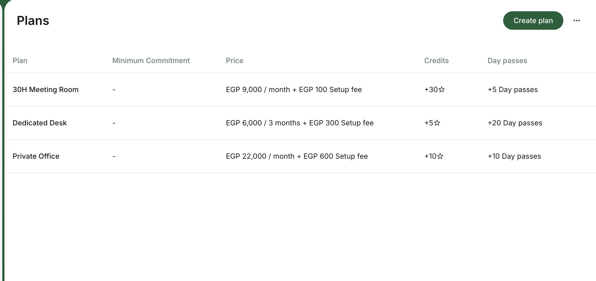
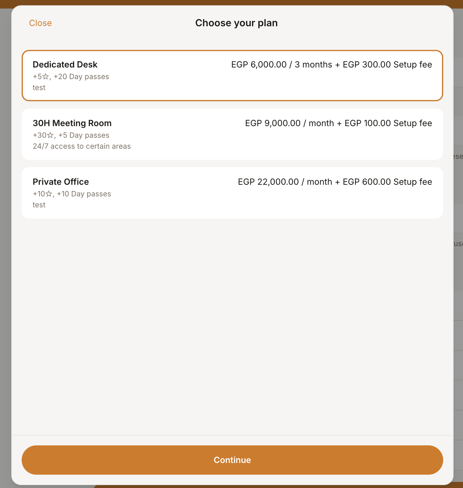
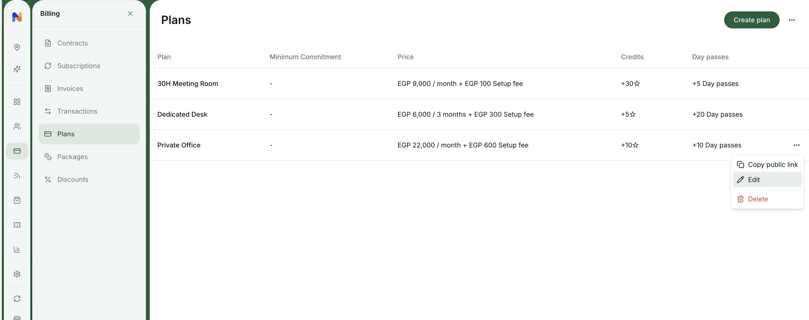
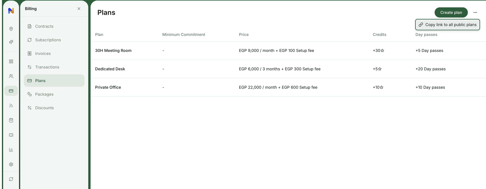

أنشئ وأدِر خطط العضوية للوصول طويل الأجل أو المتكرر دون استئجار مورد مخصص

العضويات هي خيارات وصول متكرر أو مجموعات من الخدمات، مثل عضوية المكتب المرن أو عضوية عشرة أيام في الشهر. تحتوي كل عضوية على خطة واحدة أو أكثر، مثل خطة شهرية وخطة سنوية، ولكل خطة سعرها ودورة الفوترة والمخصصات الخاصة بها.

باستخدام العضويات، يمكنك:

- هيكلة خيارات العضوية وعرضها على العملاء
- السماح للعملاء بالتسجيل فورًا أو تقديم الطلبات
- إعداد عملاء جدد للاشتراكات بسرعة، باستخدام الخطط كقوالب.

## إعداد الخطط

1. انتقل إلى **الكتالوج** > **العضويات**.
2. انقر على **إنشاء عضوية**.
3. أدخل اسم العضوية ووصفها، وأضف صورها وإعدادات الوصول الحصري حسب الحاجة.
4. ضمن **الخطط**، انقر على **إضافة خطة** واضبط إعداداتها أدناه. أضف خطة لكل خيار فوترة تقدمه.

<Frame>
  
</Frame>

### إعداد الخطة

- **Name** — يظهر على فواتير العملاء.
- **Cycle** — مدة صلاحية الخطة ومدى تكرار تجديد الاشتراك. الخيارات المتاحة: أسبوع واحد، شهر واحد، 3 أشهر، 6 أشهر، أو سنة واحدة.
- **Description** — التفاصيل التي يراها العملاء حول ما تتضمنه الخطة.
- **Price** — رسوم دورة واحدة.
- **Setup fee** — رسوم لمرة واحدة تُضاف إلى أول فاتورة للعميل.

<Info>
  رسوم الإعداد خاضعة للضريبة، لكنها لا تتأثر بالخصومات أو بتقسيم الفاتورة (proration).
</Info>

- [**Custom tax rate**](/ar/admin/billing/taxes/custom-tax-rates) — يتجاوز معدل الضريبة الافتراضي للموقع لهذه الخطة.
- **Minimum commitment** — الحد الأدنى الإلزامي لعدد الدورات التي يمكن للعميل الاشتراك فيها.
- [**Credits**](/ar/admin/billing/credits-and-day-passes/credits) — أرصدة قابلة لانتهاء الصلاحية يحصل عليها العميل كل دورة لاستخدامها في الحجوزات أو المشتريات.
- [**Day passes**](/ar/admin/billing/credits-and-day-passes/day-passes) — تصاريح يومية قابلة لانتهاء الصلاحية يحصل عليها العميل كل دورة لحجز المكاتب المرنة (hot desks).
- [**Discounts**](/ar/admin/billing/discounts/apply-discounts-to-bookings-and-purchases) — تقديم خصومات على خدمات معينة للأعضاء المشتركين في هذه الخطة.
- **Sign-up** — التحكم في ما إذا كان بإمكان العملاء رؤية هذه الخطة والاشتراك فيها وكيفية ذلك.

### إعداد التسجيل

| الإعداد | النتيجة |
| --- | --- |
| التفعيل بنوع **Immediate** | يمكن للعملاء رؤية هذه الخطة و[التسجيل فورًا](/ar/admin/billing/plans/immediate-plan-sign-ups#how-users-sign-up-for-plans) دون تدخل من المسؤول. |
| التفعيل بنوع **Request** | يمكن للعملاء رؤية هذه الخطة و[تقديم طلب](/ar/admin/billing/plans/applications-for-plans#how-users-apply-for-a-plan) للاشتراك. يتعامل المسؤولون مع الطلبات كتذاكر دعم. مفيد إذا كنت لا تسمح للعملاء الجدد بأن يصبحوا أعضاء بشكل مستقل. |
| تعطيل **Sign-up** | تبقى الخطة مرئية فقط للمسؤولين لاستخدامها في [إنشاء الاشتراكات](/ar/admin/billing/subscriptions/set-up-subscriptions). |

- [**Access**](/ar/admin/integrations/access-control) — مجموعة التحكم في الوصول. تظهر إذا كان لديك [التكامل مع نظام التحكم في الوصول](/ar/admin/integrations/access-control).
- [**Printing**](/ar/admin/integrations/printing/ezeep-blue) — مجموعة صلاحيات الطباعة.
- **Exclusive access** — يتمتع العملاء المشتركون في هذه الخطة بوصول حصري لعرض الموارد أو حجزها.

5. احفظ الخطة، ثم اضغط **حفظ** في نافذة العضوية لحفظ العضوية وخططها.

<Info>
  الخطط مصممة للوصول دون مورد مخصص. أما المكاتب المخصصة أو المكاتب الفردية أو غيرها من المؤجَّرات — سواء كانت طويلة الأجل أو متكررة أو بالوصول الساعي أو اليومي — فيتم إعدادها في [Resources](/ar/admin/resource-management/resources/set-up-pricing).
</Info>

## الخطوات التالية

بعد إنشاء عضوياتك:

- يمكن للعملاء استكشاف الخطط المتاحة و[التسجيل](/ar/admin/billing/plans/immediate-plan-sign-ups) أو [تقديم الطلبات](/ar/admin/billing/plans/applications-for-plans)، وفقًا لإعداداتك.

<Frame>
  
</Frame>

- يمكن للمسؤولين بسرعة [إعداد أعضاء جدد للاشتراكات](/ar/admin/billing/subscriptions/set-up-subscriptions)، باستخدام الخطط كقوالب جاهزة بأسعار ومزايا وصلاحيات وصول محددة مسبقًا.

## تعديل خطة أو حذفها

1. انتقل إلى **الكتالوج** > **العضويات**.
2. افتح قائمة **(...)** بجوار العضوية واختر **تعديل**.
3. ضمن **الخطط**، اختر الخطة لتعديلها أو استخدم قائمتها لحذفها.
4. اضغط **حفظ** لحفظ التغييرات.

لحذف العضوية كاملة، اختر **حذف** من قائمة صف العضوية.

<Frame>
  
</Frame>

<Info>
  يمنع RNTOR حذف عضوية أو إزالة خطة إذا كانت سجلات الفوترة أو الإيجارات الحالية ما زالت مرتبطة بها.
</Info>

<Warning>
  لإيقاف التسجيلات الجديدة، [عطّل **التسجيل**](/ar/admin/billing/plans/set-up-plans) في خطط العضوية. وتبقى الخطط متاحة للمسؤولين عند إنشاء الاشتراكات.
</Warning>

## الأسئلة الشائعة

<AccordionGroup>
  <Accordion title="كيف أنشئ خطة مخصصة لعميل واحد؟">
    ابدأ في [إنشاء الاشتراك](/ar/admin/billing/subscriptions/set-up-subscriptions) للعميل، وأبقِ خيار **Custom** في حقل **Product**، ثم اكتب يدويًا اسم الخطة وسعرها والمخصصات الأخرى.
  </Accordion>

  <Accordion title="كيف أنسخ رابط جميع العضويات المتاحة للعامة؟">
    انتقل إلى **الكتالوج** > **العضويات** > اضغط على القائمة `...` في الزاوية العلوية اليمنى > **نسخ رابط جميع العضويات العامة**.

    <Frame>
      
    </Frame>
  </Accordion>

  <Accordion title="هل يمكنني تقديم خصومات على الخطط؟">
    لتقديم خصومات موجَّهة على خطط معينة أو لعملاء محددين، أنشئ [كوبونات وأكواد ترويجية](/ar/admin/billing/discounts/apply-discounts-to-bookings-and-purchases#create-promo-codes) من نوع **Subscription items**.

    [طبّقها](/ar/admin/billing/discounts/apply-discounts-to-bookings-and-purchases) مباشرة عند إنشاء الاشتراكات للمستخدمين والشركات، أو شارك [الكود الترويجي](/ar/admin/billing/discounts/apply-discounts-to-bookings-and-purchases#create-promo-codes) مع العملاء ليستخدموا الخصم بأنفسهم عند التسجيل.
  </Accordion>

  <Accordion title="كيف أقدّم باقة ساعات لحجز الغرف؟">
    يمكنك استخدام أي من الخيارات التالية:

    - [**Create a membership plan with credits**](/ar/admin/billing/plans/set-up-plans): مثالي للحزم المتكررة. يشترك العملاء في خطة ويحصلون تلقائيًا على عدد محدد من الأرصدة القابلة لانتهاء الصلاحية في كل دورة لاستخدامها في الحجوزات.
    - [**Create a credit package**](/ar/admin/billing/credits-and-day-passes/packages): الأفضل للمشتريات لمرة واحدة. يمكن للعملاء شراء حزمة أرصدة لمرة واحدة في أي وقت واستخدامها في الحجوزات.
  </Accordion>

  <Accordion title="هل تؤثر تعديلات الخطة على اشتراكات الأعضاء الحاليين؟">
    تنطبق التغييرات على الخطة فقط على الاشتراكات المستقبلية الجديدة، وعلى الأعضاء الحاليين الذين فعّلوا خيار **Auto-update from plan** في اشتراكهم.

    لتطبيق تغييرات الخطة على الأعضاء الحاليين، لديك خياران:

    - [**تعديل اشتراكاتهم**](/ar/admin/billing/subscriptions/edit-a-subscription) فرديًا وتطبيق التغييرات يدويًا، أو
    - تفعيل **Auto-update from plan** في اشتراكات العملاء الحاليين، ثم إجراء تغيير على الخطة. بهذه الطريقة، ستُطبَّق التغييرات تلقائيًا على الأعضاء الحاليين أيضًا.
  </Accordion>

  <Accordion title="كيف أرفع سعر الخطة لجميع العملاء المشتركين فيها؟">
    تأكد من [تفعيل إعداد **Auto-update from plan**](/ar/admin/billing/subscriptions/edit-a-subscription) في جميع اشتراكات عملائك النشطة المرتبطة بهذه الخطة. ثم قم بتعديل الخطة حسب الحاجة.

    - أي تغييرات على الأسعار أو الأرصدة أو التصاريح اليومية ستُطبَّق تلقائيًا على اشتراكاتهم مع بداية دورة الفوترة التالية.
    - التغييرات على الخصومات والوصول إلى الأبواب والوصول الحصري إلى الموارد تُطبَّق فورًا.
  </Accordion>
</AccordionGroup>

```text
```
