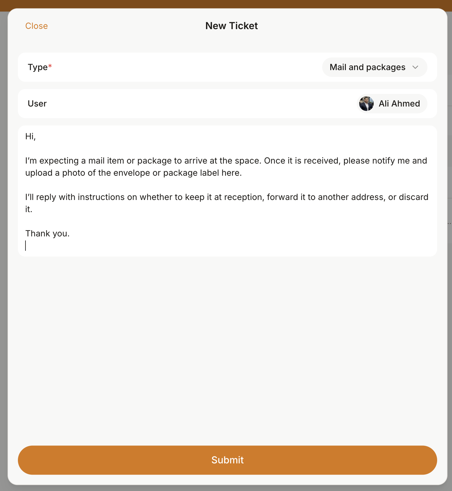
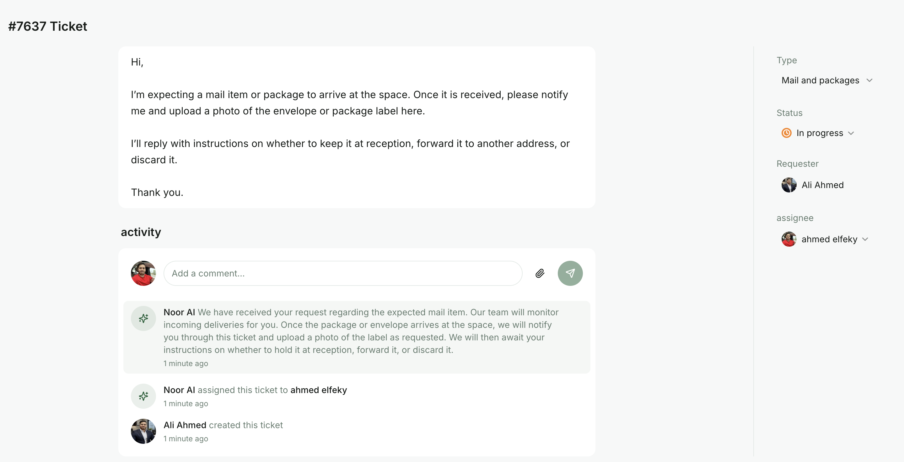

قدّم عضوية مكتب افتراضي تشمل عنوان العمل وخدمات التعامل مع البريد. استخدم طلبات العضوية لمراجعة العميل عند الحاجة، وسجّل البريد والطرود في قسم **الطرود**.

## إنشاء خطة مكتب افتراضي

قم بأتمتة اشتراكات المكتب الافتراضي والفوترة الخاصة بها من خلال إنشاء خطة مخصصة:

1. انتقل إلى **الكتالوج > العضويات** ثم انقر على [إنشاء عضوية](/ar/admin/billing/plans/set-up-plans).
2. أدخل اسم العضوية، مثل المكتب الافتراضي الذهبي، واكتب وصف الخدمات المضمّنة.
3. ضمن **الخطط**، انقر على **إضافة خطة** وحدد اسم الخطة وسعرها ودورة الفوترة.
3. عند إنشاء الخطة، فعّل [مفتاح **التسجيل**](/ar/admin/billing/plans/set-up-plans) واختر نوع التسجيل المطلوب.

ونتيجة لذلك، سيقوم العملاء إما [بالتسجيل في هذه الخطة](/ar/admin/billing/plans/immediate-plan-sign-ups) بأنفسهم على الفور أو [التقدم بطلب للحصول عليها](/ar/admin/billing/plans/applications-for-plans)، وستصلك الطلبات في صفحة **الدعم > التذاكر**.

## التعامل مع عمليات التسليم

1. عند وصول بريد أو طرد، انتقل إلى **مكتب الاستقبال** > **الطرود**.
2. اضغط على **إضافة طرد**، وحدد المستخدم أو الشركة المستلمة.
3. أضف تعليقًا يوضح ما وصل ومكان استلامه.

<Frame>
  
</Frame>

4. أضف صور الظرف أو الطرد في **الصور**، ثم اضغط على **إنشاء**.

<Frame>
  
</Frame>

5. يمكن للمستلم فتح تفاصيل التسليم المعلّق من بوابة الأعضاء.
6. بعد تسليم البريد أو الطرد، افتح قائمة السجل واختر **تحديد كمستلم**. استخدم عوامل تصفية الحالة والعميل والتاريخ للعثور على السجل لاحقًا.

## الأسئلة الشائعة

<Accordion title="كيف أطلب مستندات التحقق قبل قبول العضوية؟">
  اختر **طلب** لنوع التسجيل في خطة المكتب الافتراضي، ثم تواصل مع مقدم الطلب عبر تذكرة الدعم قبل إنشاء الاشتراك.
</Accordion>

<Accordion title="هل تمنح عضوية المكتب الافتراضي وصولًا إلى الأبواب؟">
  راجع مجموعة **Access** في الخطة المحفوظة والتكامل المتصل قبل منح الوصول. وجود عنوان بريدي ضمن العضوية لا يحدد وحده صلاحيات الأبواب.
</Accordion>
