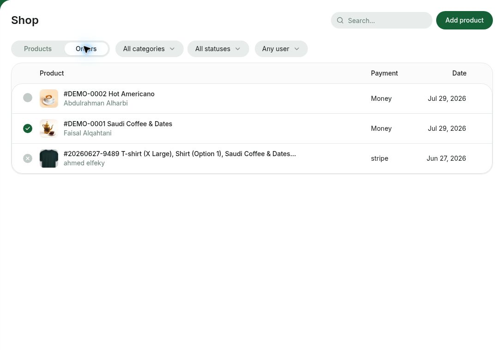
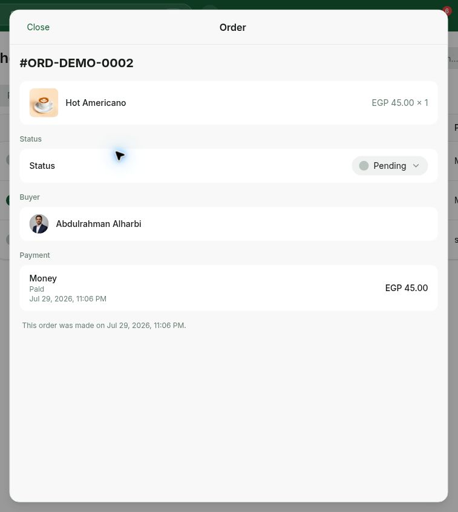
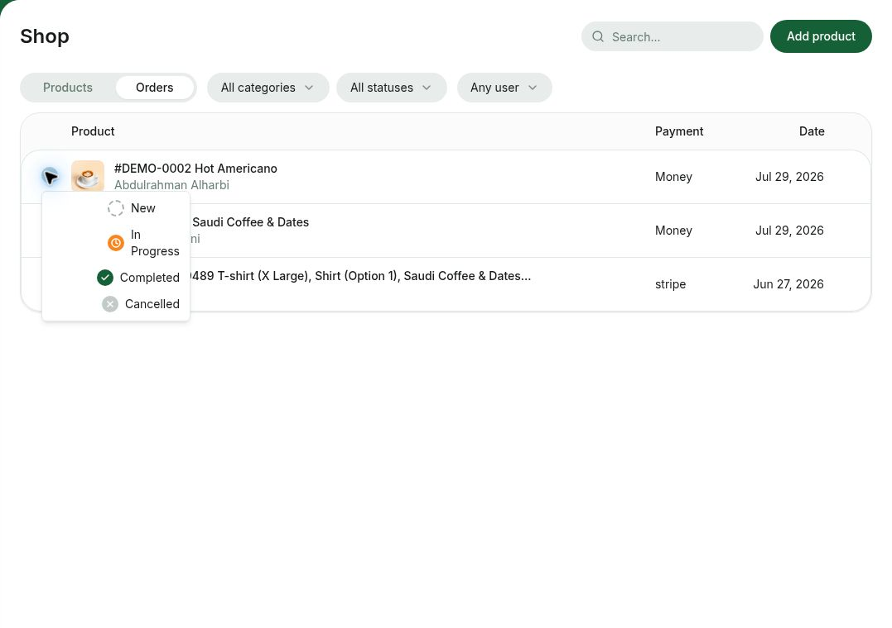
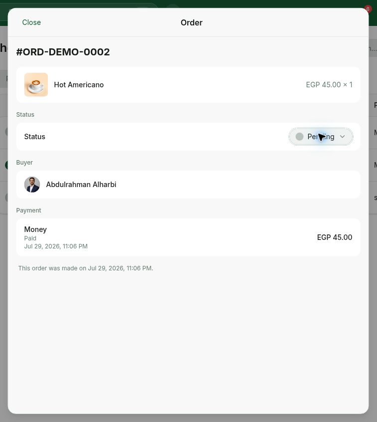
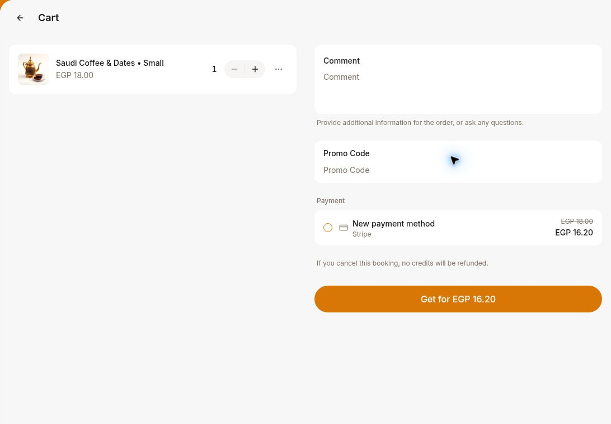

يمكن للمسؤولين تتبع إيرادات الطلبات وإدارة كل طلب بتغيير حالته أو البحث عنه.

عند إنشاء طلب، يظهر في **الكتالوج** > **المنتجات** > علامة تبويب **الطلبات**، وتُرتب الطلبات من الأحدث إلى الأقدم.

## إنشاء طلب للعميل

1. افتح **الكتالوج** > **المنتجات** واضغط على **إنشاء طلب**.
2. اختر العميل. إذا لم يكن مسجلًا، استخدم **غير عضو جديد** في قائمة العملاء.
3. أضف المنتجات وخياراتها والكميات، ثم أدخل تعليقًا عند الحاجة.
4. اختر **مجاني** أو **خارجي** من طرق الدفع المعروضة. عند اختيار **خارجي**، حدد **مدفوع** فقط إذا تأكدت من استلام المبلغ؛ وإلا فاتركه **معلقًا**.
5. راجع الإجمالي والضريبة والتوفر، ثم اضغط على **إنشاء طلب**. إذا تغيّر السعر، راجع القيمة المحدثة قبل التأكيد.

## إدارة الطلبات

بعد أن [ينشئ العميل طلبًا](/ar/member/shop)، افتحه من علامة تبويب **الطلبات** لعرض تفاصيله:

| القيمة | الوصف |
| :-- | :-- |
| رقم الطلب | لكل طلب رقم فريد داخل الموقع، مثل #30. |
| الخيار | نوع المنتج أو نسخته المختارة. |
| الكمية | عدد خيارات المنتج المطلوبة. |
| الحالة | تميز بين متابعة الدفع وتنفيذ الطلب: **معلق** بانتظار اكتمال الدفع، ثم **جديد** أو **قيد التنفيذ** أو **مكتمل** بحسب التنفيذ، و**ملغى** للطلب الملغى. راجع تفاصيل الدفع قبل تجهيز الطلب. |
| المشتري | العميل الذي أنشأ الطلب. |
| الدفع | طريقة الدفع التي اختارها العميل. |

<Tip>
  [اضبط الإشعارات](/ar/admin/administration/your-account/notifications/set-up-notifications) لتلقي تنبيه فوري بالطلبات الجديدة.
</Tip>

### البحث عن الطلبات وتصفيتها

استخدم عوامل التصفية في علامة تبويب **الطلبات**:

- **الحالة** لعرض الطلبات الجديدة أو قيد التنفيذ أو المكتملة أو الملغاة.
- **الفئة** لعرض طلبات فئة محددة في المتجر.
- **المنتج** لعرض الطلبات التي تتضمن منتجًا محددًا.
- **المستخدم** لعرض جميع طلبات عميل محدد.
- **تاريخ الإنشاء** لعرض الطلبات المنشأة في تاريخ محدد أو قبله أو بعده أو بين تاريخين.

### تغيير حالة الطلب

المسؤولون فقط هم من يمكنهم تغيير حالة الطلب. اضغط على أيقونة **الحالة** بجوار الطلب، أو افتح الطلب واستخدم حقل **الحالة**، ثم اختر الحالة الجديدة. يتلقى العميل [إشعارًا فوريًا](/ar/member/account/notifications) عند تغيير حالة طلبه.

### إلغاء طلب وإصدار مبلغ مسترد

افتح الطلب واستخدم إجراء الإلغاء المتاح، ثم راجع تأكيد الإلغاء وأهلية الاسترداد. إذا ظهر خيار طلب الاسترداد، اختره وفق سياسة المنتج. بعد الإلغاء، تحقق من نتيجة الاسترداد في المعاملة أو الفاتورة؛ حالة **ملغى** وحدها لا تعني إعادة المال. وقد يبقى التأكيد معلقًا أثناء التحقق من الدفع. [تعرّف إلى المبالغ المستردة](/ar/admin/billing/payments/refunds).

## عرض حالة الطلب

يمكن للمستخدم عرض حالة طلبه كما يلي:

1. اضغط على صورة ملفه أسفل اليمين لفتح صفحة **الحساب**.
2. انتقل إلى قسم **الطلبات** لعرض حالات طلباته.

## تحليل حالات الطلبات

اعرض نظرة مجمعة على الطلبات ذات كل حالة من صفحة **التحليلات**:

1. افتح صفحة **التحليلات** واختر لوحة **المتجر**.
2. راجع مخطط **الطلبات حسب الحالة** وحدد الفترة الزمنية المطلوبة.

## تصدير الطلبات

اضبط عوامل التصفية المطلوبة، ثم افتح قائمة الصفحة واختر **تصدير بيانات الطلبات** لتنزيل CSV. راجع الفترة والفلاتر قبل استخدام الملف؛ فهو يعكس قائمة الطلبات المصفاة.

## الأسئلة الشائعة

<Accordion title="ما معنى أن الطلب معلق؟">
  لم يكتمل تأكيد الدفع بعد. افتح تفاصيل الدفع وتحقق من حالة العملية قبل بدء تجهيز الطلب. إذا كان الدفع خارجيًا، تحقق من استلامه فعليًا قبل تسجيله كمدفوع.
</Accordion>

<Accordion title="هل إلغاء الطلب يعيد المبلغ فورًا؟">
  لا تعتمد على حالة الطلب وحدها. تعتمد النتيجة على طريقة الدفع وسياسة الاسترداد وحالة العملية. راجع سجل المعاملة أو الفاتورة للتأكد من مبلغ الاسترداد وحالته.
</Accordion>

<Accordion title="كيف أتجنب تكرار طلب عند بطء الاستجابة؟">
  راجع الطلبات الموجودة ونتيجة العملية الحالية قبل إنشاء طلب جديد. إذا تعذر تأكيد النتيجة، احتفظ ببيانات العملية للمراجعة.
</Accordion>
