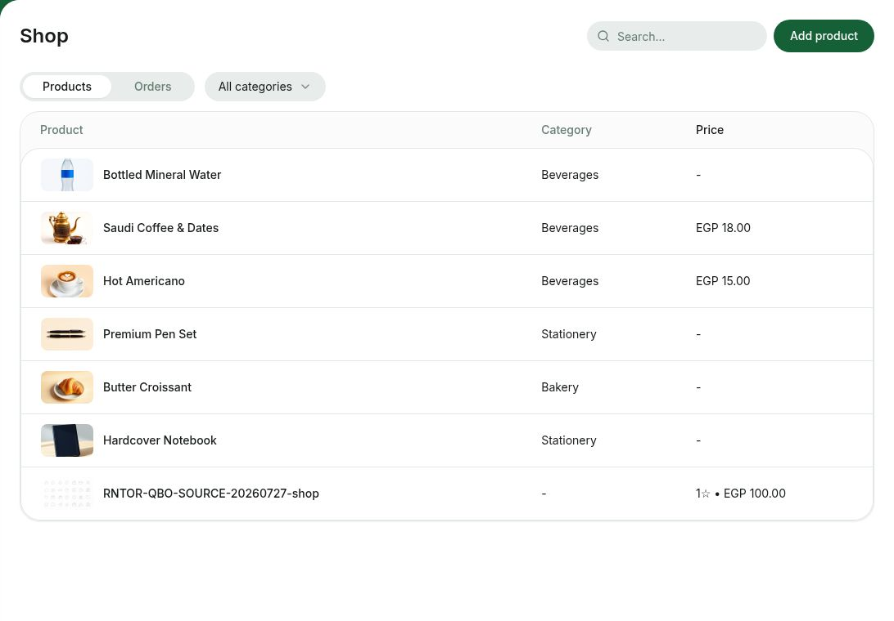
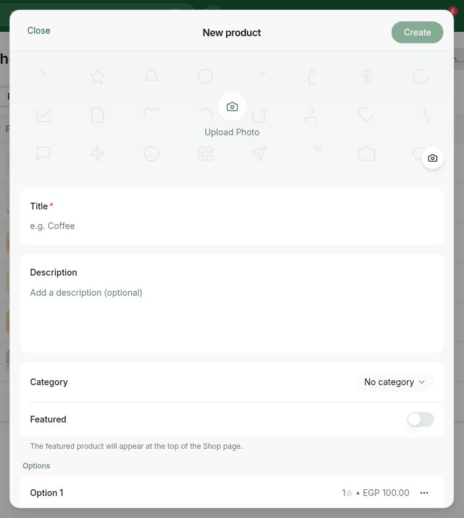
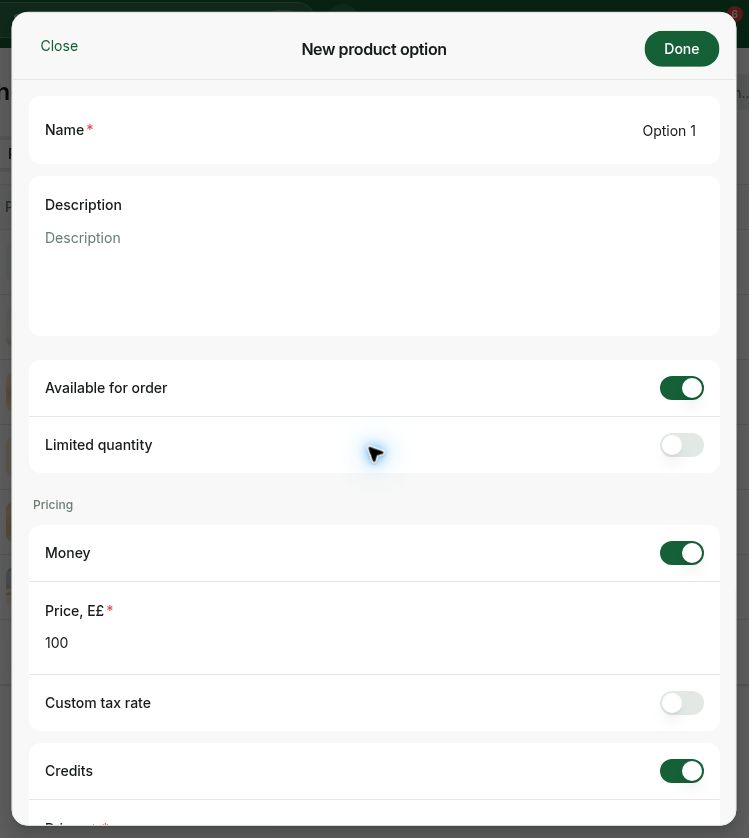
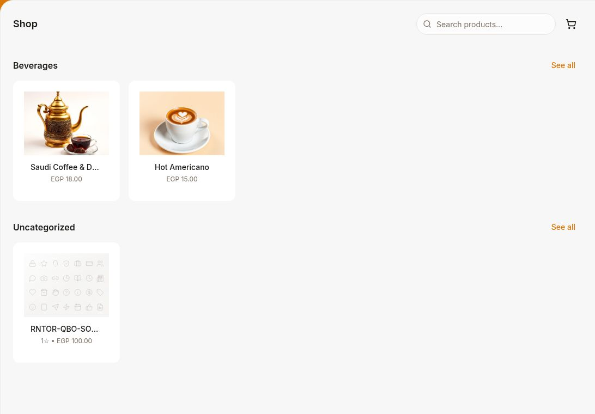
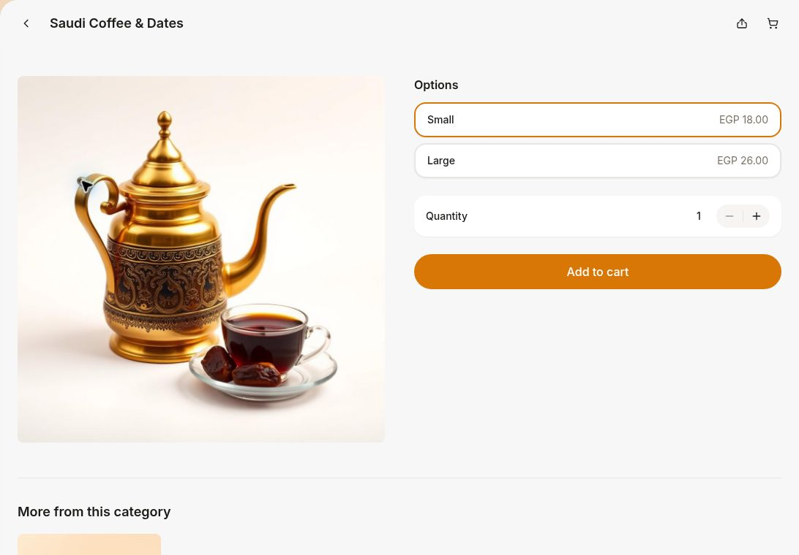
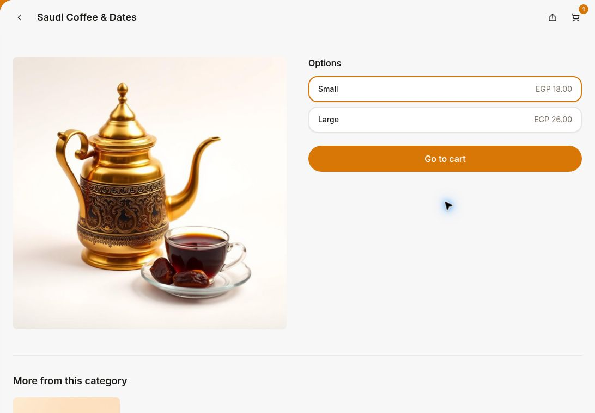

بع لعملائك خدمات ومنتجات إضافية، مثل الأطعمة أو المنتجات الدعائية، عبر **المتجر**.

## تفعيل المتجر

1. اضغط على قائمة **(...)** بجوار اسم الموقع في اللوحة الجانبية.
2. انتقل إلى **إعدادات الموقع** > **الكتالوج**.
3. فعّل مفتاح **المتجر**.
4. أنشئ فئات لتجميع المنتجات حسب نوعها، مثل **المقهى** أو **المنتجات الدعائية** أو **الخدمات**.

<Info>
  تُضاف الفئة الجديدة إلى نهاية القائمة. اسحب الفئات وأفلتها لتحديد ترتيب عرضها.
</Info>

5. فعّل مفتاح **رسالة تأكيد الطلب** و[خصص قالب رسالة التأكيد](/ar/admin/general/customize-emails).

<Info>
  اضبط نص رسالة تأكيد الطلب في إعدادات الكتالوج عند تفعيل إرسالها. يمكنك إدخال النص بالعربية والإنجليزية.
</Info>

## إضافة المنتجات

1. انتقل إلى **الكتالوج** > **المنتجات** واضغط على **إضافة منتج** أعلى اليسار.

2. اضبط تفاصيل المنتج:

| خاصية المنتج | معناها |
| :-- | :-- |
| صورة الغلاف | صورة بنسبة عرض إلى ارتفاع 2:1. |
| العنوان | اسم المنتج. |
| الوصف | التفاصيل التي يحتاج المستخدم إلى معرفتها عند الطلب. |
| الفئة | الفئة التي ينتمي إليها المنتج. |
| مميز | عند تفعيله، يُثبّت المنتج بصورة بارزة أعلى صفحة **المتجر**. |
| الخيارات | أضف نسخ المنتج المختلفة. فمثلًا يمكن أن تكون خيارات القميص المقاسات والألوان، وخيارات القهوة **لاتيه** أو **أمريكانو**. اضبط لكل خيار: <ul><li>**الاسم** — اسم الخيار.</li><li>**الوصف** — تفاصيل إضافية عنه.</li><li>**متاح للطلب** — فعّله لإتاحة الخيار؛ وعند تعطيله يظهر الخيار باهتًا وغير متاح.</li><li>**كمية محدودة** — فعّله عند توفر مخزون محدود وأدخل الكمية. يعرض النظام الخيار **نفد من المخزون** تلقائيًا بعد طلب الكمية كاملة. [<u>إدارة توفر المنتجات</u>](#إدارة-توفر-المنتجات)</li><li>**التسعير** — حدد سعر القطعة بالنقود أو الأرصدة أو كليهما، وعيّن [<u>معدلًا ضريبيًا مخصصًا</u>](/ar/admin/billing/taxes/custom-tax-rates) إذا اختلف عن المعدل الافتراضي للموقع.</li></ul> |
| الطلب | <ul><li>**مفعّل** — يظهر زر **طلب** ليستطيع المستخدم شراء المنتج.</li><li>**معطّل** — يستطيع المستخدم قراءة الوصف دون تقديم طلب.</li></ul> |
| سياسة الاسترداد | اختر **بدون استرداد** أو **فقط إذا كان جديدًا**. راجع أهلية الطلب ونتيجة عملية الاسترداد عند الإلغاء؛ تغيير حالة الطلب وحده لا يثبت إعادة المال. |
| الظهور | اجعل المنتج ظاهرًا للمسؤولين أو أعضاء الموقع أو أعضاء الشبكة أو للعامة. |

<Tip>
  يمكنك [إنشاء منتجات المتجر بالجملة](/ar/admin/noor-ai/bulk-create-resources-products-events-and-benefits) باستخدام مساعد RNTOR.
</Tip>

## كيفية عمل المتجر

- يستعرض العملاء المنتجات ويشترونها من صفحة **المتجر**. تعرّف إلى [كيفية طلب المستخدمين للمنتجات](/ar/member/shop).
- يستطيع المسؤول أيضًا [إضافة أي منتج من المتجر كعنصر إلى فاتورة العميل أو عقده أو اشتراكه](/ar/guides/revenue-and-space-optimization/recurring-add-ons).
- استخدم ميزة **الترويج** لإنشاء منشور في الخلاصة عن المنتج وجذب انتباه العملاء، سواء للإعلان عن منتج جديد أو تجديد الاهتمام بمنتج موجود.

## إدارة توفر المنتجات

يمكنك التحكم بمرونة في توفر منتجات المتجر وخياراتها وكمياتها وتحديثها.

### تعيين كمية محدودة

يناسب خيار **كمية محدودة** المنتجات ذات المخزون المحدد، مثل المنتجات الدعائية.

1. انتقل إلى **الكتالوج** > **المنتجات**.
2. [أنشئ](/ar/admin/service/shop/set-up-shop) منتجًا أو [عدّله](#تعديل-منتج-أو-حذفه).
3. افتح خيارًا محددًا داخل المنتج.
4. فعّل مفتاح **كمية محدودة** وأدخل عدد الوحدات المتاحة.

<Info>
  لا يظهر خيار **كمية محدودة** إلا عند تفعيل **متاح للطلب** لخيار المنتج.
</Info>

**كيف يعمل ذلك؟**

- يتتبع النظام مبيعات هذا الخيار ويحدث توفره تلقائيًا.
- عندما يتبقى عنصران أو عنصر واحد، تظهر للمستخدم شارة **متبقي 2** أو **متبقي 1**.
- عند شراء المخزون كاملًا، تظهر شارة **نفد من المخزون**.

- يمكنك إعادة تعبئة مخزون الخيار في أي وقت عبر [تعديل كميته](#تعديل-منتج-أو-حذفه)، وسيتمكن المستخدمون من مواصلة طلبه.

### تعطيل طلب خيار محدد

إذا أصبح خيار بعينه غير متاح مؤقتًا، يمكنك تعطيل هذا الخيار وحده:

1. انتقل إلى **الكتالوج** > **المنتجات**.
2. [أنشئ](/ar/admin/service/shop/set-up-shop) منتجًا أو [عدّله](#تعديل-منتج-أو-حذفه).
3. افتح الخيار المطلوب.
4. عطّل مفتاح **متاح للطلب**.

يظهر الخيار باهتًا وغير متاح، بينما تظل خيارات المنتج الأخرى متاحة.

### تعطيل طلب المنتج كاملًا

لإيقاف بيع منتج كامل مؤقتًا:

1. انتقل إلى **الكتالوج** > **المنتجات**.
2. [أنشئ](/ar/admin/service/shop/set-up-shop) منتجًا أو [عدّله](#تعديل-منتج-أو-حذفه).
3. عطّل مفتاح **الطلب**.

يبقى المنتج ظاهرًا في صفحة **المتجر** من دون زر **طلب**، ولذلك لا يستطيع المستخدمون شراءه.

<Info>
  يمكنك إعادة إتاحة خيار المنتج أو المنتج كاملًا للطلب في أي وقت.
</Info>

<Info>
  يمكنك أيضًا إخفاء المنتج مؤقتًا عن جميع المستخدمين بتغيير **ظهوره** إلى **المسؤولون** من صفحة [تعديل المنتج](#تعديل-منتج-أو-حذفه).
</Info>

## تعديل منتج أو حذفه

1. انتقل إلى **الكتالوج** > **المنتجات**.
2. مرر المؤشر فوق المنتج، واضغط على قائمة **(...)** بجواره ثم **تعديل** أو **حذف**.

<Info>
  بعد تعديل المنتج، راجع ظهوره وخياراته من بوابة الأعضاء. يمكنك استخدام **الترويج** لنشر تحديث عنه في الخلاصة.
</Info>

<Info>
  راجع [سياسة الاسترداد](/ar/admin/billing/payments/refunds) وبيانات الطلب قبل معالجة الإلغاء أو إبلاغ العميل بموعد استرداد المبلغ.
</Info>

<Warning>
  حذف المنتج نهائي ولا يمكن التراجع عنه.
</Warning>

## تعديل فئة منتجات أو حذفها

1. انتقل إلى **إعدادات الموقع** > **الكتالوج**.
2. اضغط على قائمة **(...)** بجوار الفئة المطلوبة ثم **تعديل** أو **حذف**.

<Warning>
  قبل حذف فئة، راجع منتجاتها وانقل المنتجات التي تريد الاحتفاظ بها إلى فئة أخرى. أكد حذف الفئة بعد مراجعة محتوياتها.
</Warning>

## تصفية المنتجات وتصديرها

استخدم البحث وعامل تصفية **الفئة** في **الكتالوج** > **المنتجات**. من قائمة الصفحة، اختر **تصدير بيانات المنتجات** لتنزيل القائمة المصفاة بصيغة CSV. ولحذف عدة منتجات، اختر **تحديد عناصر**، وحدد المنتجات، ثم راجع اختيارك قبل **حذف**.

## الأسئلة الشائعة

<Accordion title="ما الفرق بين تعطيل الطلب وإخفاء المنتج؟">
  تعطيل **الطلب** يبقي تفاصيل المنتج ظاهرة دون إمكانية الشراء. أما ضبط **الظهور** على **المسؤولون فقط** فيخفيه عن العملاء. لتعطيل نسخة واحدة، أوقف **متاح للطلب** في خيارها.
</Accordion>

<Accordion title="كيف أضيف مخزونًا جديدًا لخيار نفد؟">
  افتح المنتج ثم الخيار، وراجع **متاح للطلب** و**كمية محدودة**، وأدخل الكمية المتاحة فعليًا ثم احفظ التغييرات.
</Accordion>

<Accordion title="هل يستطيع المسؤول إنشاء طلب للعميل؟">
  نعم. اضغط على **إنشاء طلب** من **الكتالوج** > **المنتجات** واتبع [خطوات إنشاء الطلب](/ar/admin/service/shop/manage-orders#إنشاء-طلب-للعميل).
</Accordion>
